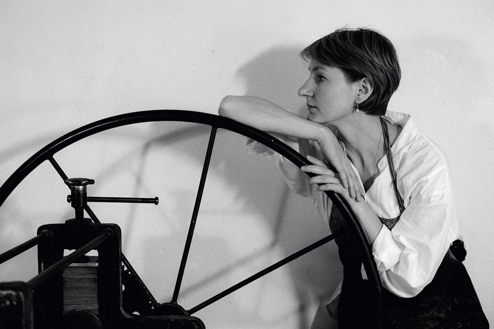

::: {.about-grid}
::: {}
{fig-alt="Marina Maroz at the etching press" .nolightbox .portrait}
:::

::: {}
[Marina Maroz (b. 1984, Minsk) is a graphic artist and printmaker whose practice centres on etching, in particular mezzotint and soft ground etching.]{.lead-serif}

Her work focuses on monochrome symbolic still lifes exploring themes of faith and sacrifice, abandonment and hope, as well as the relationship between human and divine.

She received her MFA in Graphic Arts from the Belarusian State Academy of Arts in Minsk in 2008. Maroz has held solo exhibitions at institutions such as the Palace of Art in Minsk, Frederikshavn Kunstmuseum & Exlibrissamling (Denmark) and the National Museum of Taras Shevchenko in Kyiv.

Her work has been widely presented in international exhibitions and triennials, including the Tokyo International Mini-Print Triennial at Tama Art University Museum, the Sint-Niklaas Biennial at the International Ex Libris Center, the Ural Print Triennial at the Bashkir Nesterov Art Museum, and the International Mezzotint Festival at Glavny Prospekt International Arts Center. She has received numerous awards, including the Grand Prix at the Art-Pradmova illustrators' contest and prizes at international print triennials.

Her works are held in public collections such as the National Taiwan Museum of Fine Arts, Tama Art University Museum, Malbork Castle Museum and Ostrów Wielkopolski City Museum, as well as in private collections internationally. She lives and works in Minsk.

::: {.cv}
### Education
<dl><dt>2008</dt><dd>MFA in Graphic Arts, Belarusian State Academy of Arts, Minsk</dd></dl>

### Solo exhibitions
<dl>
<dt>2024</dt><dd><em>Evidences</em>, Terra Graphica Sacrum, Palace of Art, Minsk, Belarus</dd>
<dt>2019</dt><dd>Frederikshavn Kunstmuseum &amp; Exlibrissamling, Frederikshavn, Denmark</dd>
<dt>2015</dt><dd><em>Nebo. Kruci. Provallja. Voda.</em>, Friendship House, Minsk, Belarus</dd>
<dt>2015</dt><dd><em>My Shore</em>, National Museum of Taras Shevchenko, Kyiv, Ukraine</dd>
<dt>2014</dt><dd><em>Own Shore</em>, Charitable Presidential Foundation of Ukraine, Kyiv, Ukraine</dd>
<dt>2013</dt><dd><em>Above the Stone</em>, Academy Gallery, Minsk, Belarus</dd>
</dl>

### Selected group exhibitions
<dl>
<dt>2025</dt><dd>VI International Ex Libris Competition, Largo Art Gallery, Varna, Bulgaria</dd>
<dt>2023</dt><dd><em>Autumn Salon</em>, Palace of Art, Minsk, Belarus</dd>
<dt>2022</dt><dd><em>The World of Mezzotint</em>, National Center for Contemporary Arts, Minsk, Belarus</dd>
<dt>2021</dt><dd>Triennial of Painting, Graphics and Sculpture, Palace of Art, Minsk, Belarus</dd>
</dl>

### Honours &amp; awards
<dl>
<dt>2021</dt><dd>Honourable mention, II International Print Triennial, Cieszyn, Poland</dd>
<dt>2020</dt><dd>Grand Prix, contest-exhibition of illustrators, Pradmova Intellectual Book Festival, Minsk</dd>
<dt>2020</dt><dd>3rd place, Graphics of the Year, Minsk</dd>
<dt>2019</dt><dd>3rd prize medal, Ural Print Triennial, Ufa, Bashkortostan</dd>
<dt>2018</dt><dd>3rd prize in printmaking, Biennial of Painting, Graphics and Sculpture, Minsk</dd>
</dl>

### Collections
National Taiwan Museum of Fine Arts · Tama Art University Museum, Tokyo · Malbork Castle Museum, Poland · Ostrów Wielkopolski City Museum, Poland · Alba Iulia Town Hall, Romania · Largo Art Gallery, Bulgaria · private collections in Belarus, Poland, Italy, France, Germany, Denmark and the USA
:::
:::
:::
