```{=html}
<section class="hero">
  <div class="hero-meta mono">
    <p><span class="k">01</span>Graphic artist &amp; printmaker.<br>Mezzotint, soft ground etching, ex libris.</p>
    <p><span class="k">02</span>Born 1984, Minsk.<br>MFA, Belarusian State Academy of Arts, 2008.</p>
    <p><span class="k">03</span><a href="works.html">Catalogue 2020—2025:<br>24 works in three series →</a></p>
  </div>
  <h1 class="mega" aria-label="Marina Maroz">
    <span class="mega-l1" aria-hidden="true">Marina</span>
    <span class="mega-l2" aria-hidden="true">Mar<a class="mega-o" href="works.html#harvest-time" aria-label="Open the work shown"></a>z</span>
  </h1>
  <p class="o-cap mono"><span class="o-fig">Fig. 04</span> <span class="o-text"><em>Harvest time</em>, 2025. Mezzotint on paper, ⌀ 50 cm</span></p>
</section>

<section class="statement">
  <span class="mono s-label">§ Practice</span>
  <p class="s-big">Monochrome symbolic still lifes exploring faith and sacrifice, abandonment and hope, and the relationship between the human and the divine.</p>
  <p class="s-small">Marina Maroz (b. 1984, Minsk) is a graphic artist and printmaker whose practice centres on etching, in particular mezzotint and soft ground etching. She lives and works in Minsk. <a href="about.html">About the artist →</a></p>
</section>

<section class="contents">
  <div class="ct-head mono"><span>Contents</span><span>Series</span><span>Years</span><span>Works</span></div>
  <a class="ct-row" href="works.html?s=evidences">
    <span class="ct-no mono">I</span><span class="ct-name">Evidences</span>
    <span class="ct-yrs mono">2021—2025</span><span class="ct-n mono">06</span>
    <span class="ct-strip">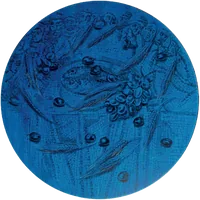</span>
  </a>
  <a class="ct-row" href="works.html?s=harvest">
    <span class="ct-no mono">II</span><span class="ct-name">Harvest</span>
    <span class="ct-yrs mono">2020—2025</span><span class="ct-n mono">06</span>
    <span class="ct-strip">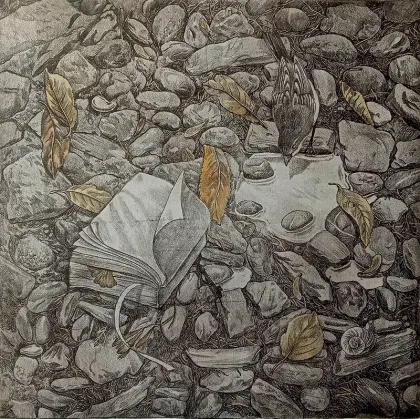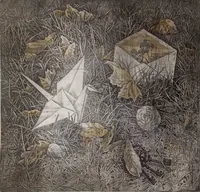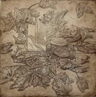</span>
  </a>
  <a class="ct-row" href="works.html?s=exlibris">
    <span class="ct-no mono">III</span><span class="ct-name">Ex libris</span>
    <span class="ct-yrs mono">2021—2025</span><span class="ct-n mono">12</span>
    <span class="ct-strip">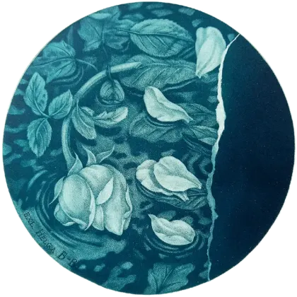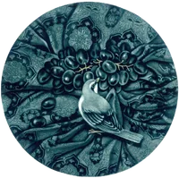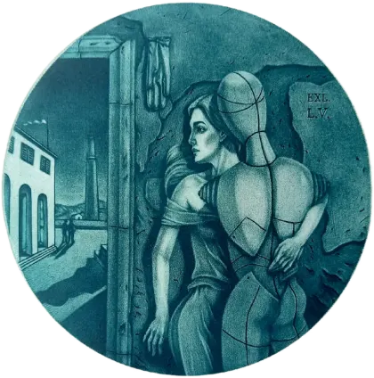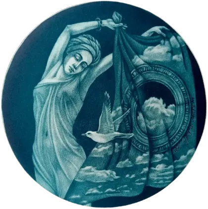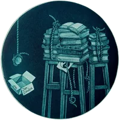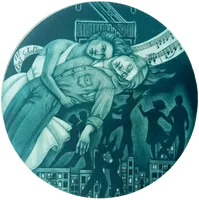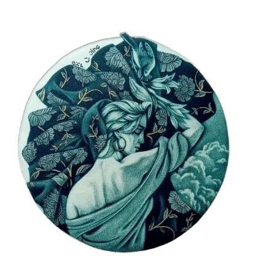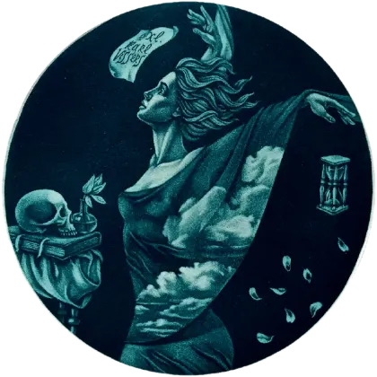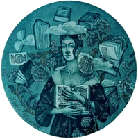</span>
  </a>
</section>

<figure class="plate-detail">
  
  <figcaption class="mono"><span>Fig. 12, detail</span><span><em>Abandoned</em>, 2020</span><span>Soft ground etching on paper, 40 × 70 cm</span><a href="works.html#abandoned">View the whole plate →</a></figcaption>
</figure>

<section class="recent">
  <span class="mono s-label">§ Recent</span>
  <ol class="rec">
    <li><span class="mono">2025</span><span>VI International Ex Libris Competition</span><span class="mono">Largo Art Gallery, Varna, Bulgaria</span></li>
    <li><span class="mono">2024</span><span><em>Evidences</em>, solo exhibition</span><span class="mono">Terra Graphica Sacrum, Palace of Art, Minsk</span></li>
    <li><span class="mono">2023</span><span><em>Autumn Salon</em></span><span class="mono">Palace of Art, Minsk</span></li>
    <li><span class="mono">2022</span><span><em>The World of Mezzotint</em></span><span class="mono">National Center for Contemporary Arts, Minsk</span></li>
  </ol>
  <a class="mono more" href="about.html#cv">Full biography &amp; CV →</a>
</section>
```
