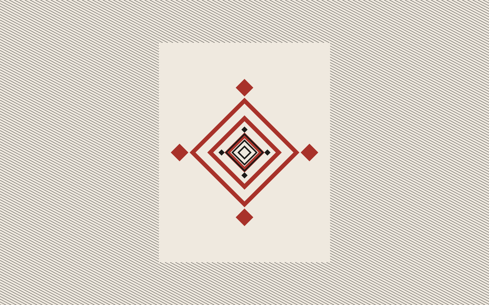
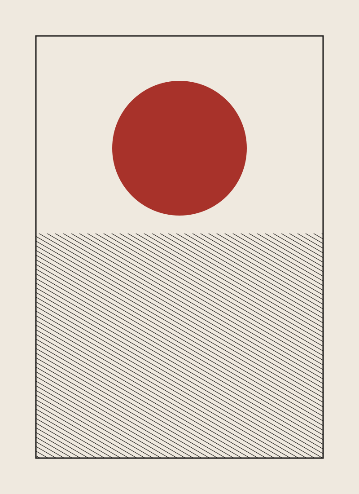
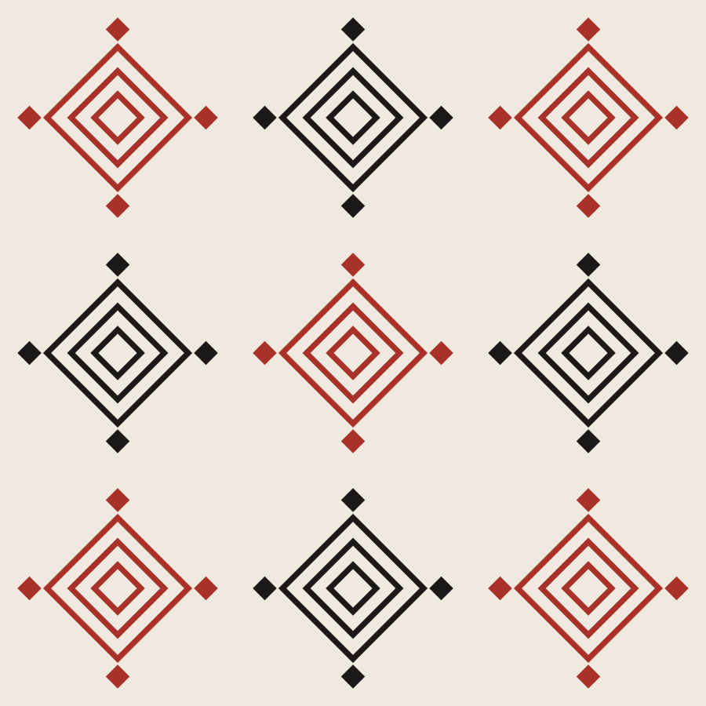

::: {.hero}
::: {.hero-text}
[Graphic artist · Belarus]{.eyebrow}

# Marina<br>*Maroz*

[Марына Мароз]{.native}

[Prints, drawings and illustration rooted in Belarusian ornament, landscape and memory — a quiet conversation between line, black ink and a single red.]{.lead-serif}

[View the works →](works.qmd){.cta}
:::

::: {.hero-art}
{fig-alt="Featured work by Marina Maroz" .nolightbox}
:::
:::

<hr class="section-rule">

[Selected works]{.eyebrow}

```{=html}
<div class="selected">
  <a href="works.html"><figure></figure>
    <div class="cap">Kupalle Sun <span>Linocut · 2024</span></div></a>
  <a href="works.html"><figure></figure>
    <div class="cap">Rushnik Study I <span>Ink on paper · 2023</span></div></a>
  <a href="works.html"><figure></figure>
    <div class="cap">Night Field <span>Etching · 2023</span></div></a>
</div>
```

<hr class="section-rule">

::: {.columns}
::: {.column width="40%"}
[Currently]{.eyebrow}
:::
::: {.column width="60%"}
[*Placeholder* — upcoming exhibition, residency or commission news goes here. Commissions and collaborations welcome — [get in touch](contact.qmd).]{.lead-serif}
:::
:::
