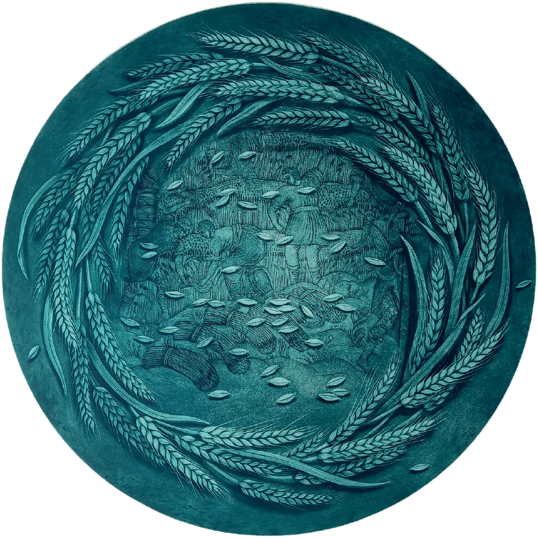
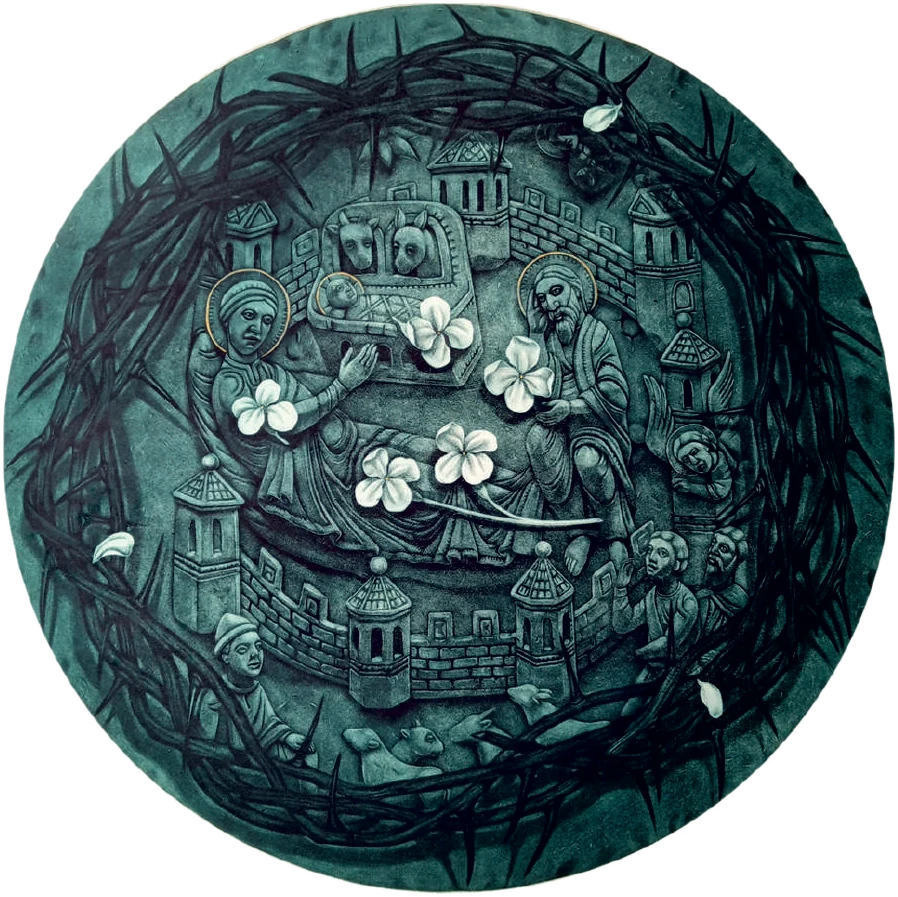
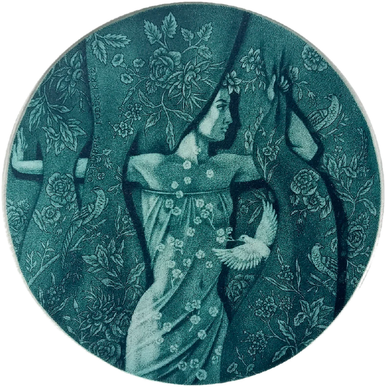
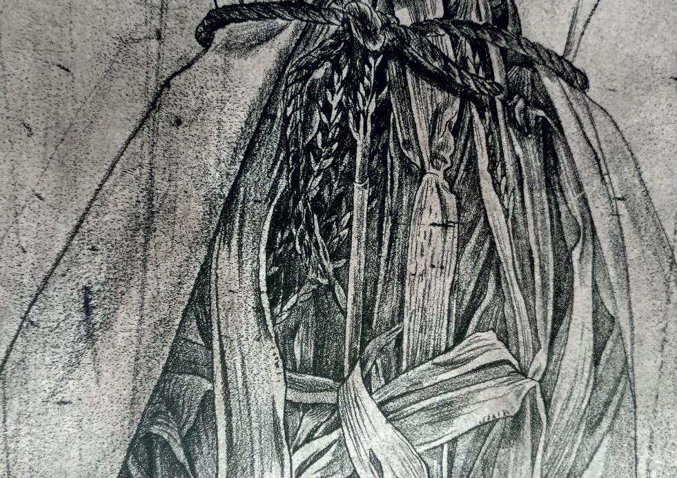

::: {.hero}
::: {.hero-text}
[Graphic artist & printmaker · Minsk]{.eyebrow}

# Marina<br>*Maroz*

[Марына Мароз]{.native}

[Mezzotint and soft ground etching. Monochrome symbolic still lifes about faith and sacrifice, abandonment and hope, and the relationship between the human and the divine.]{.lead-serif}

[View the works →](works.qmd){.cta}
:::

::: {.hero-art}
{fig-alt="Harvest time, 2025, mezzotint" .nolightbox}
:::
:::

<hr class="section-rule">

[Selected works]{.eyebrow}

```{=html}
<div class="selected">
  <a href="works.html#evidences"><figure></figure>
    <div class="cap"><em>Predestination</em> <span>Mezzotint · 2021</span></div></a>
  <a href="works.html#harvest"><figure></figure>
    <div class="cap"><em>New pearls</em> <span>Soft ground etching · 2025</span></div></a>
  <a href="works.html#exlibris"><figure></figure>
    <div class="cap"><em>In the secret garden</em> <span>Mezzotint ex libris · 2025</span></div></a>
</div>
```

```{=html}
<figure class="band"><figcaption><em>Wide open</em>, 2021, soft ground etching (detail)</figcaption></figure>
```

::: {.columns .recent}
::: {.column width="35%"}
[Recent]{.eyebrow}
:::
::: {.column width="65%"}
**2025:** VI International Ex Libris Competition, Largo Art Gallery, Varna, Bulgaria

**2024:** *Evidences*, solo exhibition, Terra Graphica Sacrum, Palace of Art, Minsk

**2022:** *The World of Mezzotint*, National Center for Contemporary Arts, Minsk

[Full CV →](about.qmd){.cta}
:::
:::
