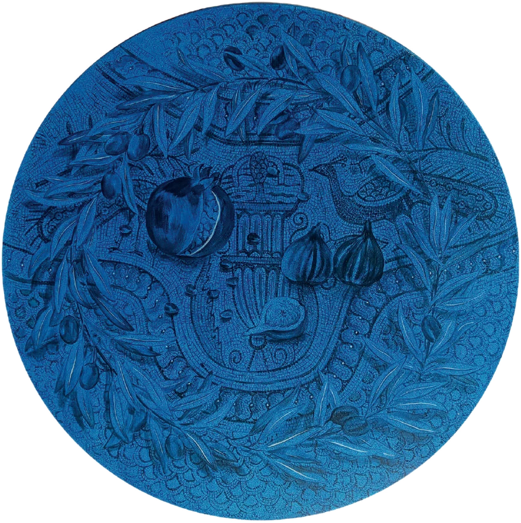
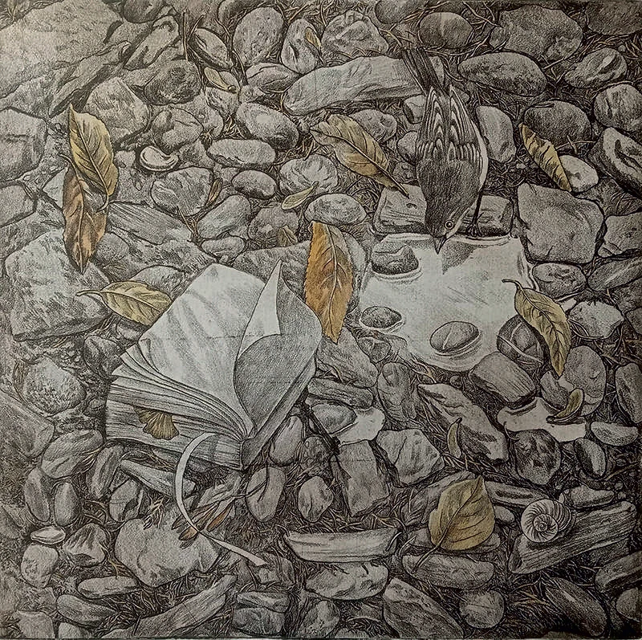
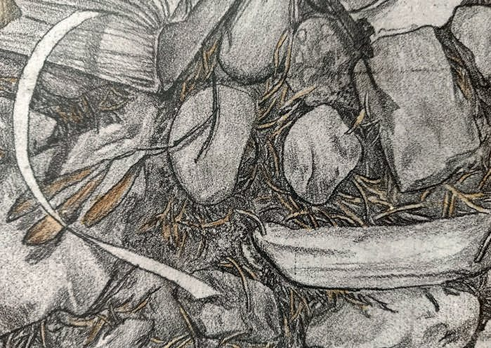
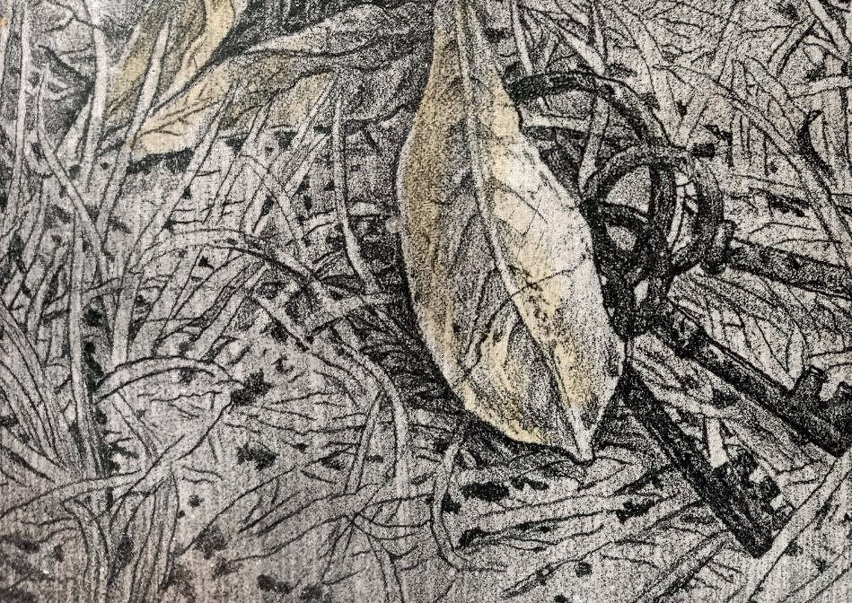
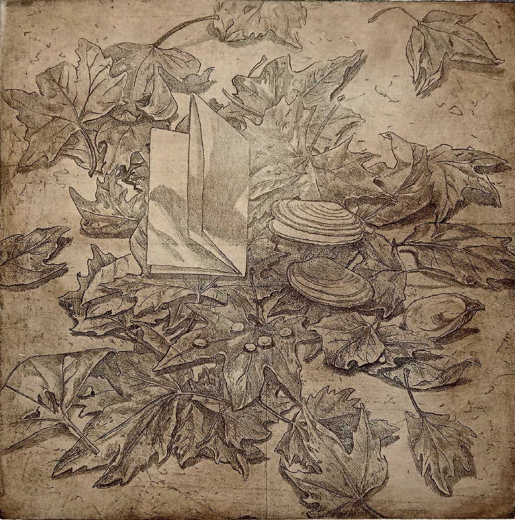
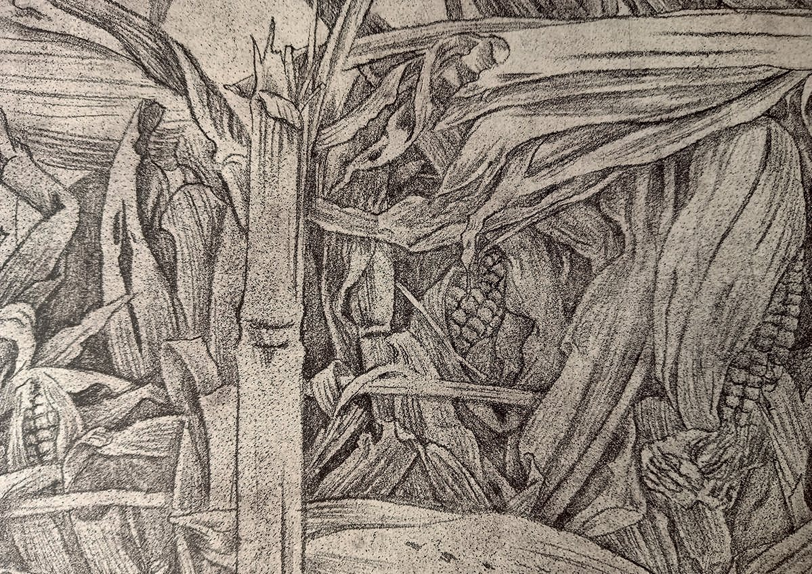
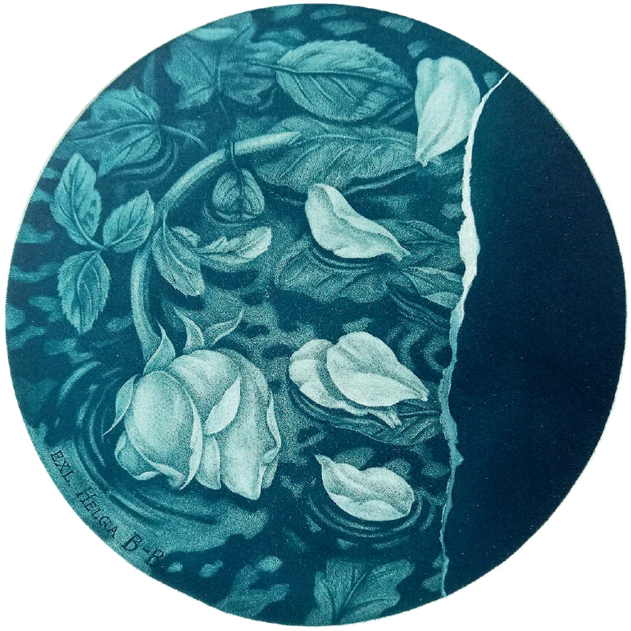
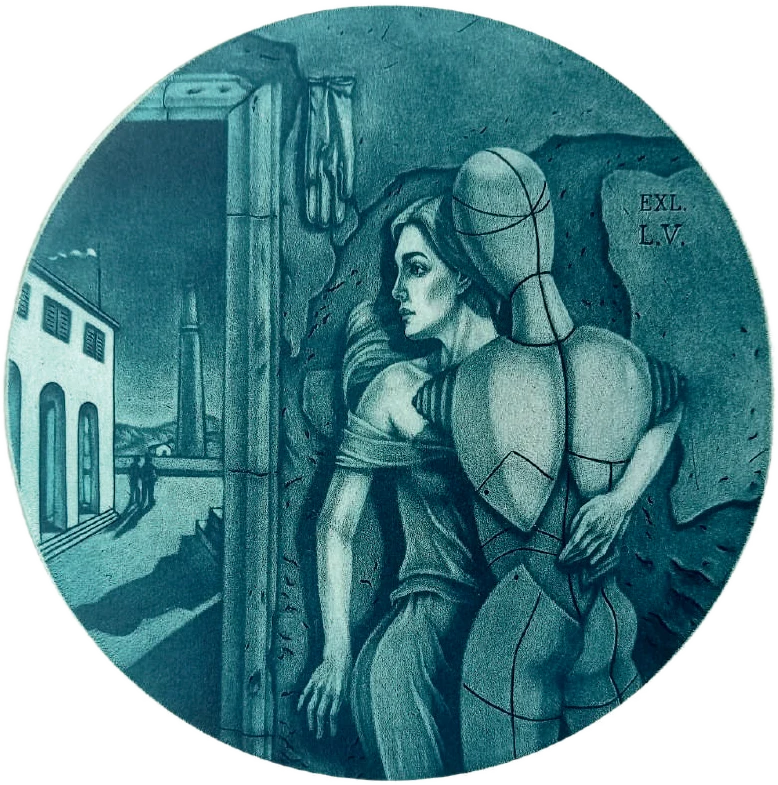
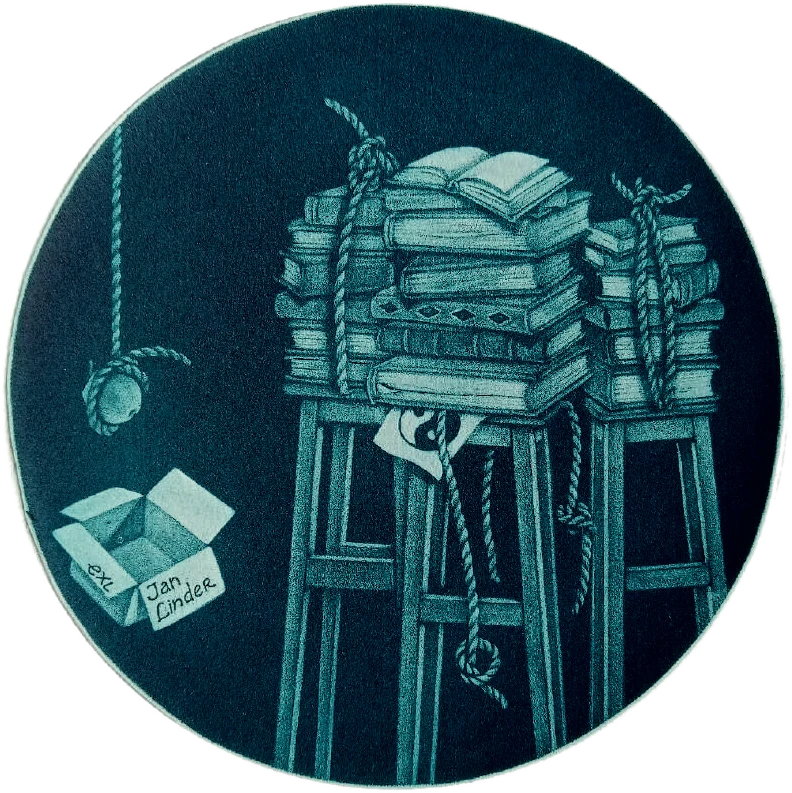
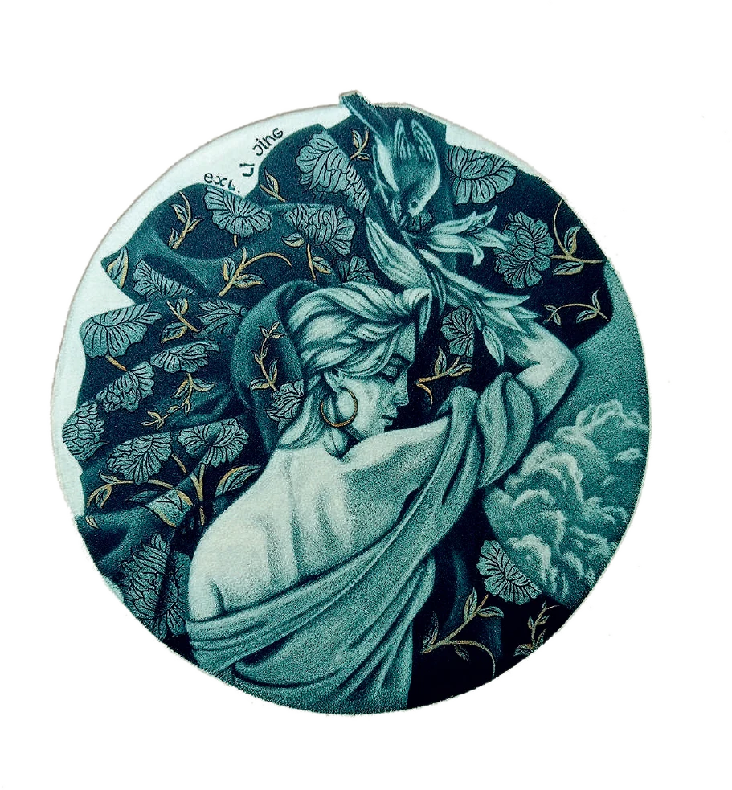

```{=html}
<div class="hud" aria-hidden="true"><span class="hud-room">Entrance</span><span class="hud-plan"><a href="#evidences" data-plan="evidences" tabindex="-1">I</a><a href="#harvest" data-plan="harvest" tabindex="-1">II</a><a href="#exlibris" data-plan="exlibris" tabindex="-1">III</a></span><span class="hud-count"><b>00</b> / 24</span></div>
<main class="exhibition" id="main">
<section class="screen entrance" data-room="entrance" id="entrance"><div class="spot" aria-hidden="true"></div><h1 class="marquee"><span class="w1">Marina</span><span class="disc"></span><span class="w2">Maroz</span></h1><p class="ent-meta l">Graphic artist &amp; printmaker<br>Mezzotint, soft ground etching, ex libris</p><p class="ent-meta r"><span lang="be">Марына Мароз</span><br>Minsk, Belarus</p><a class="enter" href="#evidences"><span>Enter</span><i>Three rooms · twenty-four works</i></a></section>
<section class="screen room-title" data-room="evidences" id="evidences"><p class="room-no">Room I</p><h2 class="room-name">Evidences</h2><div class="room-intro"><p>Round compositions in mezzotint and acrylic: symbolic still lifes on faith and sacrifice. Shown in the solo exhibition <em>Evidences</em> at Terra Graphica Sacrum, Palace of Art, Minsk, in 2024.</p><p class="room-meta">2021–2025 · 6 works</p></div><ol class="room-list"><li><a href="#reconciliation-circle"><span>01</span>Reconciliation circle</a></li><li><a href="#salvific-meal"><span>02</span>Salvific meal</a></li><li><a href="#quiet-refuge"><span>03</span>Quiet refuge</a></li><li><a href="#harvest-time"><span>04</span>Harvest time</a></li><li><a href="#great-expectations"><span>05</span>Great expectations</a></li><li><a href="#predestination"><span>06</span>Predestination</a></li></ol><span class="room-cue" aria-hidden="true">↓</span></section>
<section class="screen work" data-room="evidences" data-work="1" id="reconciliation-circle"><figure class="hang"><button class="art round" type="button" data-full="images/works/reconciliation-circle.jpg" data-n="1" aria-label="Look closer: Reconciliation circle"></button><figcaption><div class="label"><span class="no">01</span><span class="t">Reconciliation circle</span><span class="y">2025</span><span class="m">Acrylic on hardboard</span><span class="s">⌀ 50 cm</span></div><span class="closer">Look closer</span></figcaption></figure></section>
<section class="screen work" data-room="evidences" data-work="2" id="salvific-meal"><figure class="hang"><button class="art round" type="button" data-full="images/works/salvific-meal.jpg" data-n="2" aria-label="Look closer: Salvific meal"></button><figcaption><div class="label"><span class="no">02</span><span class="t">Salvific meal</span><span class="y">2025</span><span class="m">Acrylic on hardboard</span><span class="s">⌀ 50 cm</span></div><span class="closer">Look closer</span></figcaption></figure></section>
<section class="screen work" data-room="evidences" data-work="3" id="quiet-refuge"><figure class="hang"><button class="art round" type="button" data-full="images/works/quiet-refuge.jpg" data-n="3" aria-label="Look closer: Quiet refuge"></button><figcaption><div class="label"><span class="no">03</span><span class="t">Quiet refuge</span><span class="y">2025</span><span class="m">Acrylic on hardboard</span><span class="s">⌀ 50 cm</span></div><span class="closer">Look closer</span></figcaption></figure></section>
<section class="screen work" data-room="evidences" data-work="4" id="harvest-time"><figure class="hang"><button class="art round" type="button" data-full="images/works/harvest-time.jpg" data-n="4" aria-label="Look closer: Harvest time"></button><figcaption><div class="label"><span class="no">04</span><span class="t">Harvest time</span><span class="y">2025</span><span class="m">Mezzotint on paper</span><span class="s">⌀ 50 cm</span></div><span class="closer">Look closer</span></figcaption></figure></section>
<section class="screen work" data-room="evidences" data-work="5" id="great-expectations"><figure class="hang"><button class="art round" type="button" data-full="images/works/great-expectations.jpg" data-n="5" aria-label="Look closer: Great expectations"></button><figcaption><div class="label"><span class="no">05</span><span class="t">Great expectations</span><span class="y">2022</span><span class="m">Mezzotint on paper</span><span class="s">⌀ 40 cm</span></div><span class="closer">Look closer</span></figcaption></figure></section>
<section class="screen work" data-room="evidences" data-work="6" id="predestination"><figure class="hang"><button class="art round" type="button" data-full="images/works/predestination.jpg" data-n="6" aria-label="Look closer: Predestination"></button><figcaption><div class="label"><span class="no">06</span><span class="t">Predestination</span><span class="y">2021</span><span class="m">Mezzotint on paper</span><span class="s">⌀ 40 cm</span></div><span class="closer">Look closer</span></figcaption></figure></section>
<section class="screen room-title" data-room="harvest" id="harvest"><p class="room-no">Room II</p><h2 class="room-name">Harvest</h2><div class="room-intro"><p>Soft ground etchings of gathered, bound and abandoned things: stones, husks, leaves, a paper crane.</p><p class="room-meta">2020–2025 · 6 works</p></div><ol class="room-list"><li><a href="#found"><span>07</span>Found</a></li><li><a href="#good-news"><span>08</span>Good news</a></li><li><a href="#new-pearls"><span>09</span>New pearls</a></li><li><a href="#binded"><span>10</span>Binded</a></li><li><a href="#wide-open"><span>11</span>Wide open</a></li><li><a href="#abandoned"><span>12</span>Abandoned</a></li></ol><span class="room-cue" aria-hidden="true">↓</span></section>
<section class="screen work" data-room="harvest" data-work="7" id="found"><figure class="hang"><button class="art rect" type="button" data-full="images/works/found.jpg" data-n="7" aria-label="Look closer: Found"></button><figcaption><div class="label"><span class="no">07</span><span class="t">Found</span><span class="y">2023</span><span class="m">Soft ground etching on paper</span><span class="s">35 × 35 cm</span></div><span class="closer">Look closer</span></figcaption></figure></section>
<section class="screen detail" data-room="harvest" data-work="7" id="found-detail"><p class="detail-cap"><em>Found</em>, 2023 — detail</p></section>
<section class="screen work" data-room="harvest" data-work="8" id="good-news"><figure class="hang"><button class="art rect" type="button" data-full="images/works/good-news.jpg" data-n="8" aria-label="Look closer: Good news"></button><figcaption><div class="label"><span class="no">08</span><span class="t">Good news</span><span class="y">2024</span><span class="m">Soft ground etching on paper</span><span class="s">35 × 35 cm</span></div><span class="closer">Look closer</span></figcaption></figure></section>
<section class="screen detail" data-room="harvest" data-work="8" id="good-news-detail"><p class="detail-cap"><em>Good news</em>, 2024 — detail</p></section>
<section class="screen work" data-room="harvest" data-work="9" id="new-pearls"><figure class="hang"><button class="art rect" type="button" data-full="images/works/new-pearls.jpg" data-n="9" aria-label="Look closer: New pearls"></button><figcaption><div class="label"><span class="no">09</span><span class="t">New pearls</span><span class="y">2025</span><span class="m">Soft ground etching on paper</span><span class="s">35 × 35 cm</span></div><span class="closer">Look closer</span></figcaption></figure></section>
<section class="screen work" data-room="harvest" data-work="10" id="binded"><figure class="hang"><button class="art rect" type="button" data-full="images/works/binded.jpg" data-n="10" aria-label="Look closer: Binded"></button><figcaption><div class="label"><span class="no">10</span><span class="t">Binded</span><span class="y">2021</span><span class="m">Soft ground etching on paper</span><span class="s">64 × 34 cm</span></div><span class="closer">Look closer</span></figcaption></figure></section>
<section class="screen work" data-room="harvest" data-work="11" id="wide-open"><figure class="hang"><button class="art rect" type="button" data-full="images/works/wide-open.jpg" data-n="11" aria-label="Look closer: Wide open"></button><figcaption><div class="label"><span class="no">11</span><span class="t">Wide open</span><span class="y">2021</span><span class="m">Soft ground etching on paper</span><span class="s">64 × 34 cm</span></div><span class="closer">Look closer</span></figcaption></figure></section>
<section class="screen detail" data-room="harvest" data-work="11" id="wide-open-detail"><p class="detail-cap"><em>Wide open</em>, 2021 — detail</p></section>
<section class="screen work" data-room="harvest" data-work="12" id="abandoned"><figure class="hang"><button class="art rect" type="button" data-full="images/works/abandoned.jpg" data-n="12" aria-label="Look closer: Abandoned"></button><figcaption><div class="label"><span class="no">12</span><span class="t">Abandoned</span><span class="y">2020</span><span class="m">Soft ground etching on paper</span><span class="s">40 × 70 cm</span></div><span class="closer">Look closer</span></figcaption></figure></section>
<section class="screen detail" data-room="harvest" data-work="12" id="abandoned-detail"><p class="detail-cap"><em>Abandoned</em>, 2020 — detail</p></section>
<section class="screen room-title" data-room="exlibris" id="exlibris"><p class="room-no">Room III</p><h2 class="room-name">Ex libris</h2><div class="room-intro"><p>Bookplates in mezzotint, each ⌀ 14 cm: small allegories of reading, memory and dreaming.</p><p class="room-meta">2021–2025 · 12 works</p></div><ol class="room-list"><li><a href="#bittersweet-memories"><span>13</span>Bittersweet memories</a></li><li><a href="#treasure"><span>14</span>Treasure</a></li><li><a href="#hommage-de-chirico"><span>15</span>Hommage Giorgio de Chirico</a></li><li><a href="#in-flight"><span>16</span>In flight</a></li><li><a href="#cognition"><span>17</span>Cognition</a></li><li><a href="#west-side-story"><span>18</span>West Side Story</a></li><li><a href="#at-rest"><span>19</span>At rest</a></li><li><a href="#hommage-magritte"><span>20</span>Hommage René Magritte</a></li><li><a href="#in-dreams"><span>21</span>In dreams</a></li><li><a href="#vanity"><span>22</span>Vanity</a></li><li><a href="#books-catcher"><span>23</span>Books catcher</a></li><li><a href="#in-the-secret-garden"><span>24</span>In the secret garden</a></li></ol><span class="room-cue" aria-hidden="true">↓</span></section>
<section class="xl" data-room="exlibris" style="--n:12">
<span class="xl-snap" id="bittersweet-memories" data-work="13" style="top:calc(0 * 100svh)"></span>
<span class="xl-snap" id="treasure" data-work="14" style="top:calc(1 * 100svh)"></span>
<span class="xl-snap" id="hommage-de-chirico" data-work="15" style="top:calc(2 * 100svh)"></span>
<span class="xl-snap" id="in-flight" data-work="16" style="top:calc(3 * 100svh)"></span>
<span class="xl-snap" id="cognition" data-work="17" style="top:calc(4 * 100svh)"></span>
<span class="xl-snap" id="west-side-story" data-work="18" style="top:calc(5 * 100svh)"></span>
<span class="xl-snap" id="at-rest" data-work="19" style="top:calc(6 * 100svh)"></span>
<span class="xl-snap" id="hommage-magritte" data-work="20" style="top:calc(7 * 100svh)"></span>
<span class="xl-snap" id="in-dreams" data-work="21" style="top:calc(8 * 100svh)"></span>
<span class="xl-snap" id="vanity" data-work="22" style="top:calc(9 * 100svh)"></span>
<span class="xl-snap" id="books-catcher" data-work="23" style="top:calc(10 * 100svh)"></span>
<span class="xl-snap" id="in-the-secret-garden" data-work="24" style="top:calc(11 * 100svh)"></span>
<div class="xl-sticky"><div class="xl-track">
<figure class="xl-item"><button class="art round" type="button" data-full="images/works/bittersweet-memories.jpg" data-n="13" aria-label="Look closer: Bittersweet memories"></button><div class="label"><span class="no">13</span><span class="t">Bittersweet memories</span><span class="y">2023</span><span class="m">Mezzotint on paper</span><span class="s">⌀ 14 cm</span></div></figure>
<figure class="xl-item"><button class="art round" type="button" data-full="images/works/treasure.jpg" data-n="14" aria-label="Look closer: Treasure"></button><div class="label"><span class="no">14</span><span class="t">Treasure</span><span class="y">2021</span><span class="m">Mezzotint on paper</span><span class="s">⌀ 14 cm</span></div></figure>
<figure class="xl-item"><button class="art round" type="button" data-full="images/works/hommage-de-chirico.jpg" data-n="15" aria-label="Look closer: Hommage Giorgio de Chirico"></button><div class="label"><span class="no">15</span><span class="t">Hommage Giorgio de Chirico</span><span class="y">2023</span><span class="m">Mezzotint on paper</span><span class="s">⌀ 14 cm</span></div></figure>
<figure class="xl-item"><button class="art round" type="button" data-full="images/works/in-flight.jpg" data-n="16" aria-label="Look closer: In flight"></button><div class="label"><span class="no">16</span><span class="t">In flight</span><span class="y">2022</span><span class="m">Mezzotint on paper</span><span class="s">⌀ 14 cm</span></div></figure>
<figure class="xl-item"><button class="art round" type="button" data-full="images/works/cognition.jpg" data-n="17" aria-label="Look closer: Cognition"></button><div class="label"><span class="no">17</span><span class="t">Cognition</span><span class="y">2023</span><span class="m">Mezzotint on paper</span><span class="s">⌀ 14 cm</span></div></figure>
<figure class="xl-item"><button class="art round" type="button" data-full="images/works/west-side-story.jpg" data-n="18" aria-label="Look closer: West Side Story"></button><div class="label"><span class="no">18</span><span class="t">West Side Story</span><span class="y">2023</span><span class="m">Mezzotint on paper</span><span class="s">⌀ 14 cm</span></div></figure>
<figure class="xl-item"><button class="art round" type="button" data-full="images/works/at-rest.jpg" data-n="19" aria-label="Look closer: At rest"></button><div class="label"><span class="no">19</span><span class="t">At rest</span><span class="y">2022</span><span class="m">Mezzotint on paper</span><span class="s">⌀ 14 cm</span></div></figure>
<figure class="xl-item"><button class="art round" type="button" data-full="images/works/hommage-magritte.jpg" data-n="20" aria-label="Look closer: Hommage René Magritte"></button><div class="label"><span class="no">20</span><span class="t">Hommage René Magritte</span><span class="y">2022</span><span class="m">Mezzotint on paper</span><span class="s">⌀ 14 cm</span></div></figure>
<figure class="xl-item"><button class="art round" type="button" data-full="images/works/in-dreams.jpg" data-n="21" aria-label="Look closer: In dreams"></button><div class="label"><span class="no">21</span><span class="t">In dreams</span><span class="y">2021</span><span class="m">Mezzotint on paper</span><span class="s">⌀ 14 cm</span></div></figure>
<figure class="xl-item"><button class="art round" type="button" data-full="images/works/vanity.jpg" data-n="22" aria-label="Look closer: Vanity"></button><div class="label"><span class="no">22</span><span class="t">Vanity</span><span class="y">2021</span><span class="m">Mezzotint on paper</span><span class="s">⌀ 14 cm</span></div></figure>
<figure class="xl-item"><button class="art round" type="button" data-full="images/works/books-catcher.jpg" data-n="23" aria-label="Look closer: Books catcher"></button><div class="label"><span class="no">23</span><span class="t">Books catcher</span><span class="y">2023</span><span class="m">Mezzotint on paper</span><span class="s">⌀ 14 cm</span></div></figure>
<figure class="xl-item"><button class="art round" type="button" data-full="images/works/in-the-secret-garden.jpg" data-n="24" aria-label="Look closer: In the secret garden"></button><div class="label"><span class="no">24</span><span class="t">In the secret garden</span><span class="y">2025</span><span class="m">Mezzotint on paper</span><span class="s">⌀ 14 cm</span></div></figure>
</div><p class="xl-hint">Scroll to walk along the wall</p></div></section>
<section class="screen exit" data-room="exit" id="exit"><p class="room-no">Exit</p><p class="exit-text">Marina Maroz (b.&nbsp;1984, Minsk) is a graphic artist and printmaker whose practice centres on etching, in particular mezzotint and soft ground etching.</p><nav class="exit-links"><a href="about.html">About the artist <i>→</i></a><a href="works.html">List of works <i>→</i></a><a href="contact.html">Contact <i>→</i></a></nav><p class="colophon">© 2026 Marina Maroz · All images © the artist</p></section>
</main>
<div class="viewer" hidden role="dialog" aria-modal="true" aria-label="Artwork viewer"><div class="v-stage"></div><div class="v-bar"><div class="v-cap"></div><div class="v-ctl"><button type="button" class="v-prev" aria-label="Previous work">←</button><button type="button" class="v-next" aria-label="Next work">→</button><button type="button" class="v-close">Close</button></div></div><p class="v-hint">Click the print to magnify</p></div>
```
