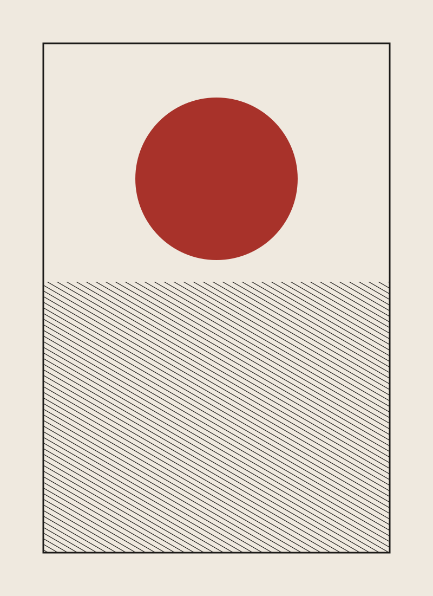
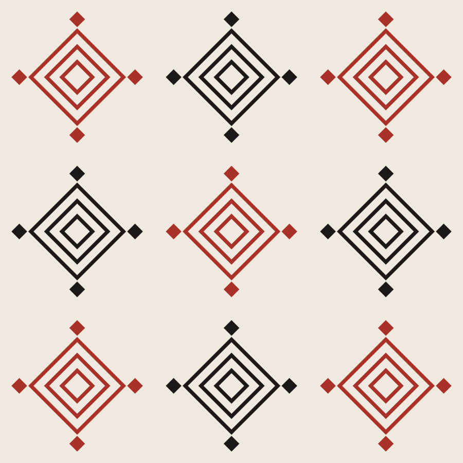
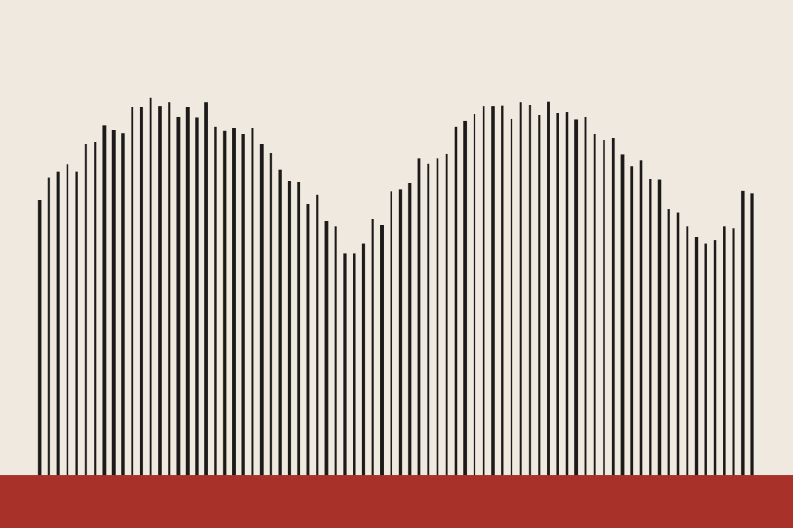
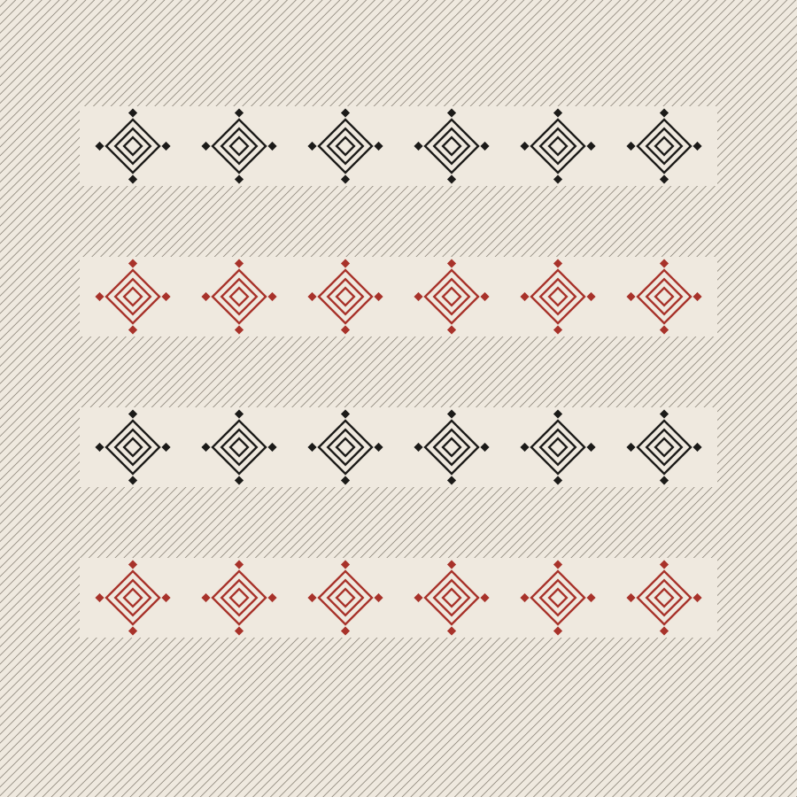
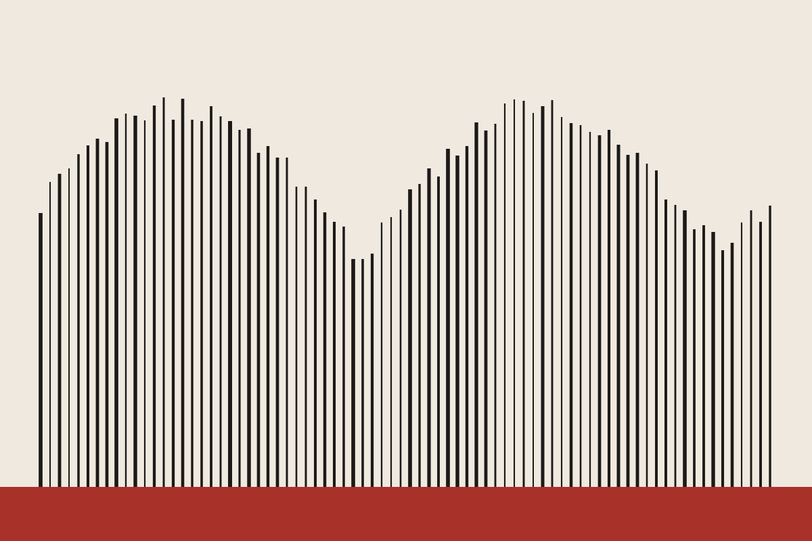
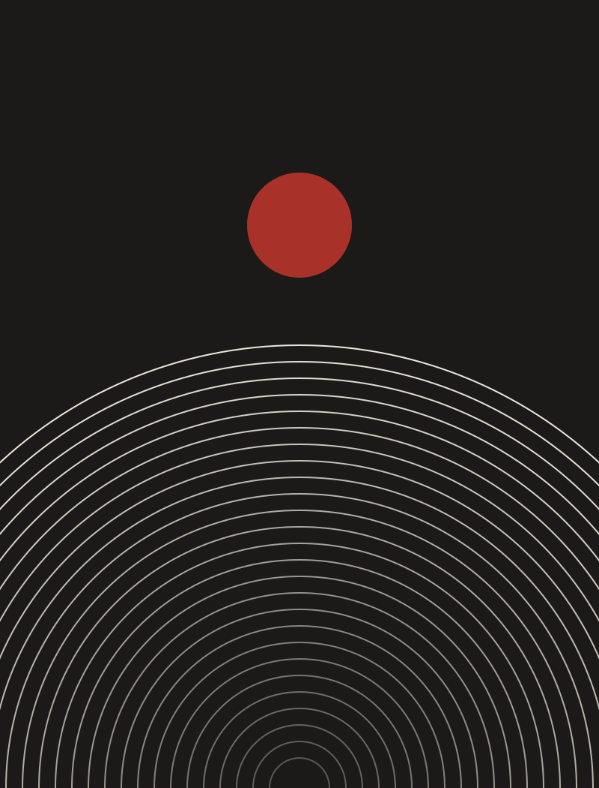
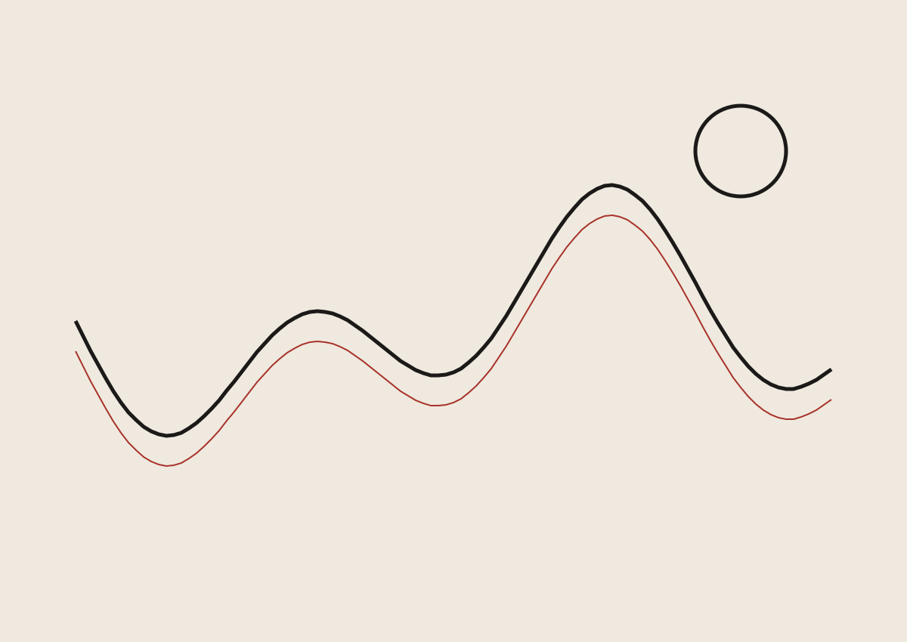

::: {.placeholder-note}
Mock content — titles, media and images are placeholders to be replaced with Marina’s actual works.
:::

```{=html}
<div class="filters" role="tablist">
  <button class="on" data-f="all">All</button>
  <button data-f="print">Printmaking</button>
  <button data-f="drawing">Drawing</button>
  <button data-f="illustration">Illustration</button>
</div>
```

:::: {.gallery}
::: {.work data-cat="print"}
{group="works" fig-alt="Kupalle Sun"}
:::

::: {.work data-cat="drawing"}
{group="works" fig-alt="Rushnik Study I"}
:::

::: {.work data-cat="print"}
{group="works" fig-alt="Horizon, Polesie"}
:::

::: {.work data-cat="print"}
{group="works" fig-alt="Night Field"}
:::

::: {.work data-cat="drawing"}
{group="works" fig-alt="Woven Bands"}
:::

::: {.work data-cat="illustration"}
{group="works" fig-alt="Flight"}
:::

::: {.work data-cat="print"}
{group="works" fig-alt="Kupalle Sun II"}
:::

::: {.work data-cat="drawing"}
{group="works" fig-alt="Rushnik Study II"}
:::

::: {.work data-cat="print"}
{group="works" fig-alt="Reeds"}
:::

::: {.work data-cat="print"}
{group="works" fig-alt="Before Dawn"}
:::

::: {.work data-cat="drawing"}
{group="works" fig-alt="Pattern for a Shirt"}
:::

::: {.work data-cat="illustration"}
{group="works" fig-alt="Stork Line"}
:::

::::

```{=html}
<script>
document.querySelectorAll('.filters button').forEach(b => b.addEventListener('click', () => {
  document.querySelectorAll('.filters button').forEach(x => x.classList.toggle('on', x === b));
  document.querySelectorAll('.gallery .work').forEach(w => w.classList.toggle('hidden', b.dataset.f !== 'all' && w.dataset.cat !== b.dataset.f));
}));
</script>
```
