```{=html}
<nav class="series-nav"><a href="#evidences">Evidences</a><a href="#harvest">Harvest</a><a href="#exlibris">Ex libris</a></nav>
```

::: {.series #evidences}
```{=html}
<header class="series-head"><h2>Evidences</h2><span class="years">2021 – 2025</span><p>Round compositions in mezzotint and acrylic: symbolic still lifes on faith and sacrifice, shown in the solo exhibition <em>Evidences</em> at Terra Graphica Sacrum, Palace of Art, Minsk (2024).</p></header>
```

:::: {.work-grid}
::::: {.work}
{group="evidences" fig-alt="Reconciliation circle, 2025" description="<em>Reconciliation circle</em>, 2025. Acrylic on hardboard, ⌀ 50 cm"}

[*Reconciliation circle*, 2025]{.t} [Acrylic on hardboard, ⌀ 50 cm]{.m}
:::::

::::: {.work}
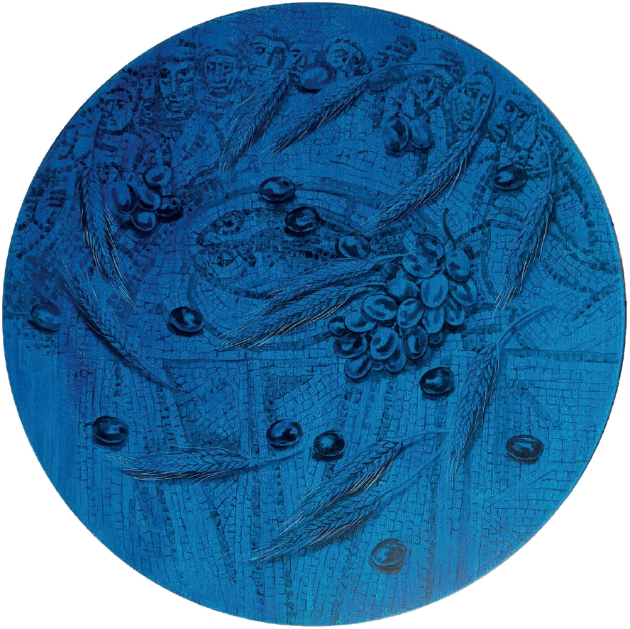{group="evidences" fig-alt="Salvific meal, 2025" description="<em>Salvific meal</em>, 2025. Acrylic on hardboard, ⌀ 50 cm"}

[*Salvific meal*, 2025]{.t} [Acrylic on hardboard, ⌀ 50 cm]{.m}
:::::

::::: {.work}
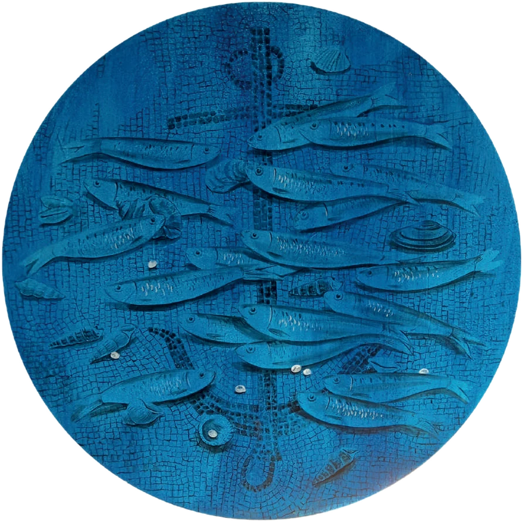{group="evidences" fig-alt="Quiet refuge, 2025" description="<em>Quiet refuge</em>, 2025. Acrylic on hardboard, ⌀ 50 cm"}

[*Quiet refuge*, 2025]{.t} [Acrylic on hardboard, ⌀ 50 cm]{.m}
:::::

::::: {.work}
{group="evidences" fig-alt="Harvest time, 2025" description="<em>Harvest time</em>, 2025. Mezzotint on paper, ⌀ 50 cm"}

[*Harvest time*, 2025]{.t} [Mezzotint on paper, ⌀ 50 cm]{.m}
:::::

::::: {.work}
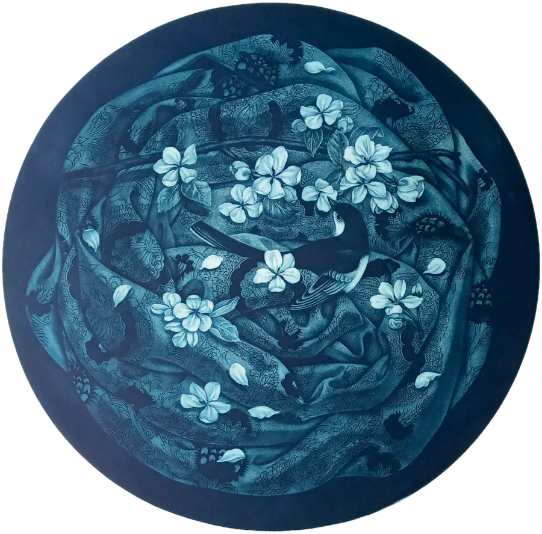{group="evidences" fig-alt="Great expectations, 2022" description="<em>Great expectations</em>, 2022. Mezzotint on paper, ⌀ 40 cm"}

[*Great expectations*, 2022]{.t} [Mezzotint on paper, ⌀ 40 cm]{.m}
:::::

::::: {.work}
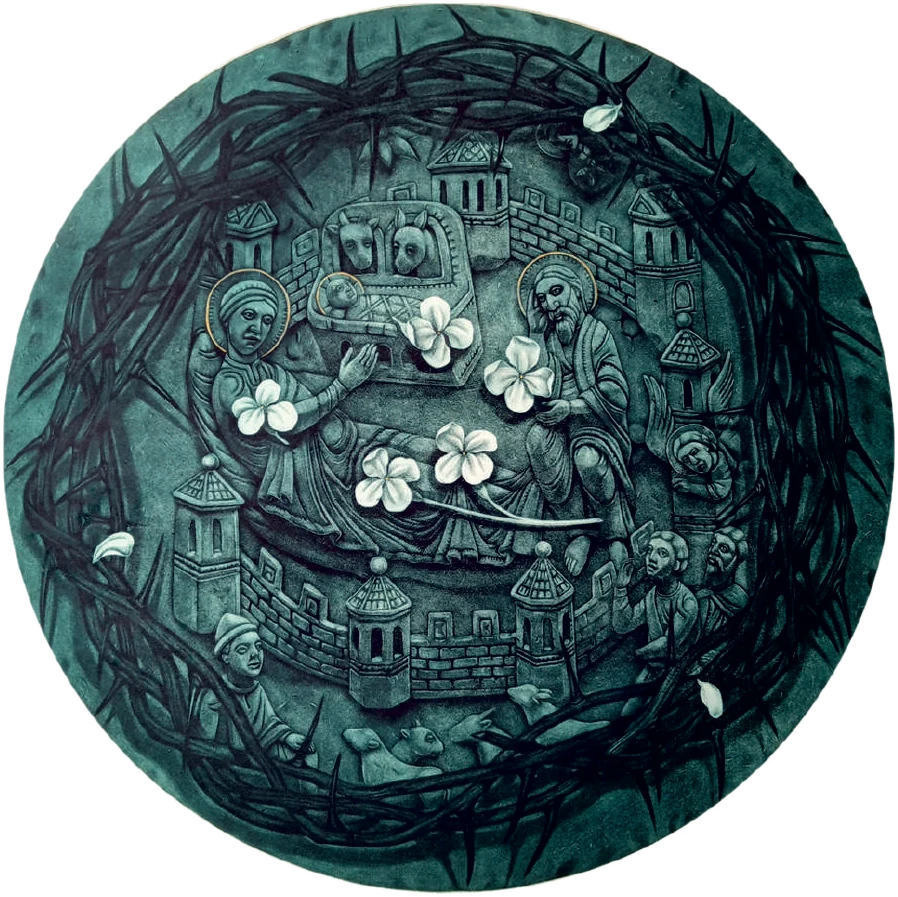{group="evidences" fig-alt="Predestination, 2021" description="<em>Predestination</em>, 2021. Mezzotint on paper, ⌀ 40 cm"}

[*Predestination*, 2021]{.t} [Mezzotint on paper, ⌀ 40 cm]{.m}
:::::

::::

:::

::: {.series #harvest}
```{=html}
<header class="series-head"><h2>Harvest</h2><span class="years">2020 – 2025</span><p>Soft ground etchings of gathered, bound and abandoned things: stones, husks, leaves, a paper crane.</p></header>
```

:::: {.work-grid}
::::: {.work}
{group="harvest" fig-alt="Found, 2023" description="<em>Found</em>, 2023. Soft ground etching on paper, 35 × 35 cm"}

[*Found*, 2023]{.t} [Soft ground etching on paper, 35 × 35 cm]{.m}
:::::

::::: {.work}
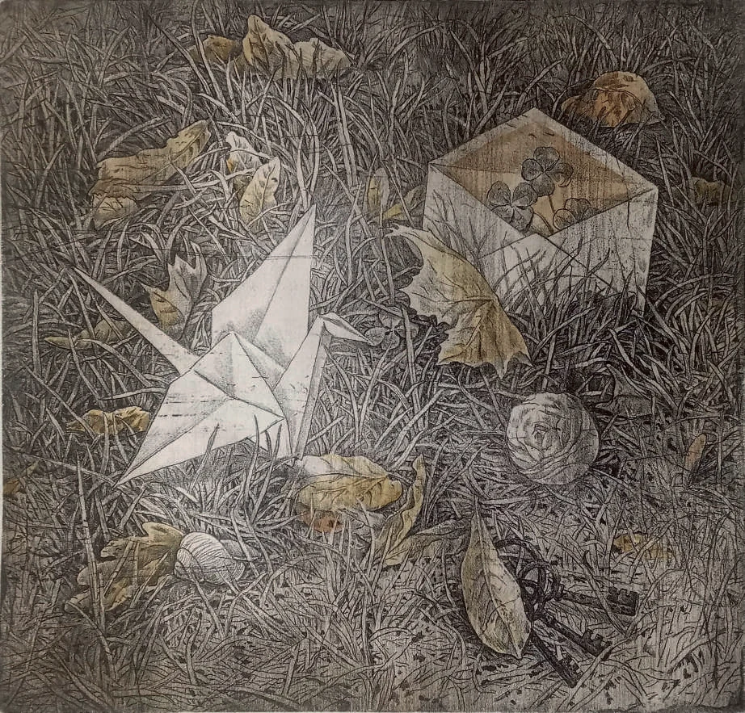{group="harvest" fig-alt="Good news, 2024" description="<em>Good news</em>, 2024. Soft ground etching on paper, 35 × 35 cm"}

[*Good news*, 2024]{.t} [Soft ground etching on paper, 35 × 35 cm]{.m}
:::::

::::: {.work}
{group="harvest" fig-alt="New pearls, 2025" description="<em>New pearls</em>, 2025. Soft ground etching on paper, 35 × 35 cm"}

[*New pearls*, 2025]{.t} [Soft ground etching on paper, 35 × 35 cm]{.m}
:::::

::::: {.work}
{group="harvest" fig-alt="Binded, 2021" description="<em>Binded</em>, 2021. Soft ground etching on paper, 64 × 34 cm"}

[*Binded*, 2021]{.t} [Soft ground etching on paper, 64 × 34 cm]{.m}
:::::

::::: {.work}
{group="harvest" fig-alt="Wide open, 2021" description="<em>Wide open</em>, 2021. Soft ground etching on paper, 64 × 34 cm"}

[*Wide open*, 2021]{.t} [Soft ground etching on paper, 64 × 34 cm]{.m}
:::::

::::: {.work}
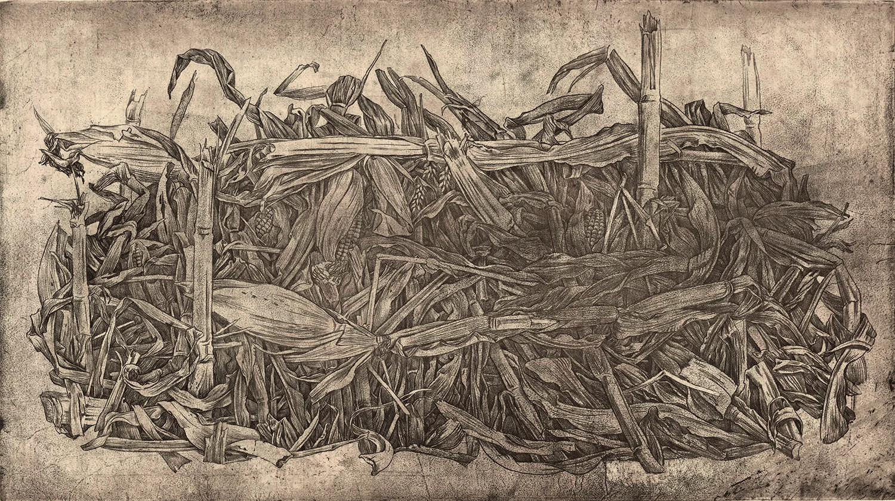{group="harvest" fig-alt="Abandoned, 2020" description="<em>Abandoned</em>, 2020. Soft ground etching on paper, 40 × 70 cm"}

[*Abandoned*, 2020]{.t} [Soft ground etching on paper, 40 × 70 cm]{.m}
:::::

::::

:::: {.details}
{group="harvest-details" fig-alt="Found (detail)" description="<em>Found</em>, 2023 (detail)"}

{group="harvest-details" fig-alt="Good news (detail)" description="<em>Good news</em>, 2024 (detail)"}

{group="harvest-details" fig-alt="Wide open (detail)" description="<em>Wide open</em>, 2021 (detail)"}

{group="harvest-details" fig-alt="Abandoned (detail)" description="<em>Abandoned</em>, 2020 (detail)"}

::::

:::

::: {.series #exlibris}
```{=html}
<header class="series-head"><h2>Ex libris</h2><span class="years">2021 – 2025</span><p>Bookplates in mezzotint, ⌀ 14 cm: small allegories of reading, memory and dreaming.</p></header>
```

:::: {.work-grid}
::::: {.work}
{group="exlibris" fig-alt="Bittersweet memories, 2023" description="<em>Bittersweet memories</em>, 2023. Mezzotint on paper, ⌀ 14 cm"}

[*Bittersweet memories*, 2023]{.t} [Mezzotint on paper, ⌀ 14 cm]{.m}
:::::

::::: {.work}
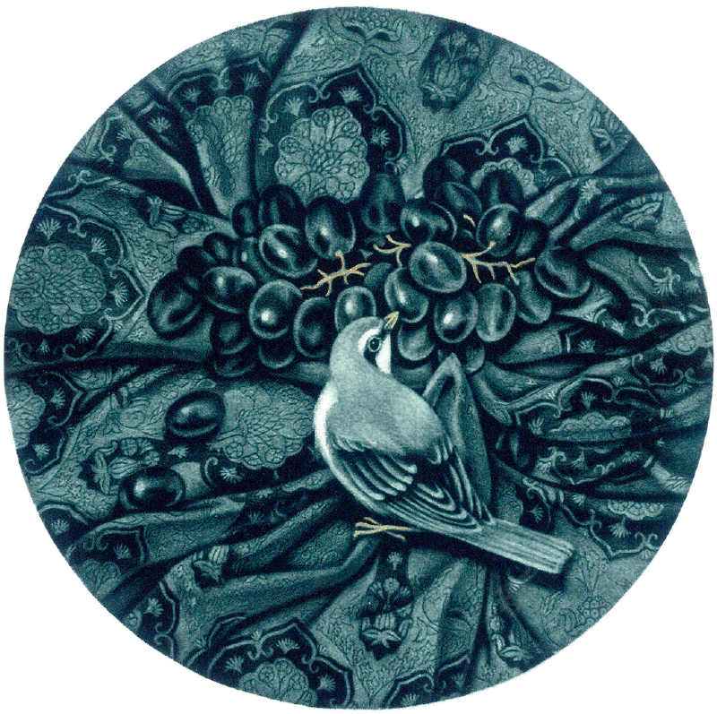{group="exlibris" fig-alt="Treasure, 2021" description="<em>Treasure</em>, 2021. Mezzotint on paper, ⌀ 14 cm"}

[*Treasure*, 2021]{.t} [Mezzotint on paper, ⌀ 14 cm]{.m}
:::::

::::: {.work}
{group="exlibris" fig-alt="Hommage Giorgio de Chirico, 2023" description="<em>Hommage Giorgio de Chirico</em>, 2023. Mezzotint on paper, ⌀ 14 cm"}

[*Hommage Giorgio de Chirico*, 2023]{.t} [Mezzotint on paper, ⌀ 14 cm]{.m}
:::::

::::: {.work}
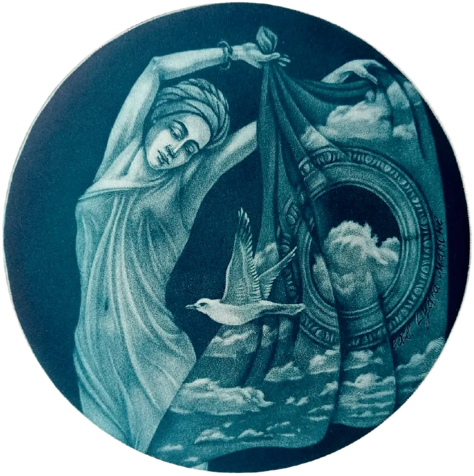{group="exlibris" fig-alt="In flight, 2022" description="<em>In flight</em>, 2022. Mezzotint on paper, ⌀ 14 cm"}

[*In flight*, 2022]{.t} [Mezzotint on paper, ⌀ 14 cm]{.m}
:::::

::::: {.work}
{group="exlibris" fig-alt="Cognition, 2023" description="<em>Cognition</em>, 2023. Mezzotint on paper, ⌀ 14 cm"}

[*Cognition*, 2023]{.t} [Mezzotint on paper, ⌀ 14 cm]{.m}
:::::

::::: {.work}
{group="exlibris" fig-alt="West Side Story, 2023" description="<em>West Side Story</em>, 2023. Mezzotint on paper, ⌀ 14 cm"}

[*West Side Story*, 2023]{.t} [Mezzotint on paper, ⌀ 14 cm]{.m}
:::::

::::: {.work}
{group="exlibris" fig-alt="At rest, 2022" description="<em>At rest</em>, 2022. Mezzotint on paper, ⌀ 14 cm"}

[*At rest*, 2022]{.t} [Mezzotint on paper, ⌀ 14 cm]{.m}
:::::

::::: {.work}
{group="exlibris" fig-alt="Hommage René Magritte, 2022" description="<em>Hommage René Magritte</em>, 2022. Mezzotint on paper, ⌀ 14 cm"}

[*Hommage René Magritte*, 2022]{.t} [Mezzotint on paper, ⌀ 14 cm]{.m}
:::::

::::: {.work}
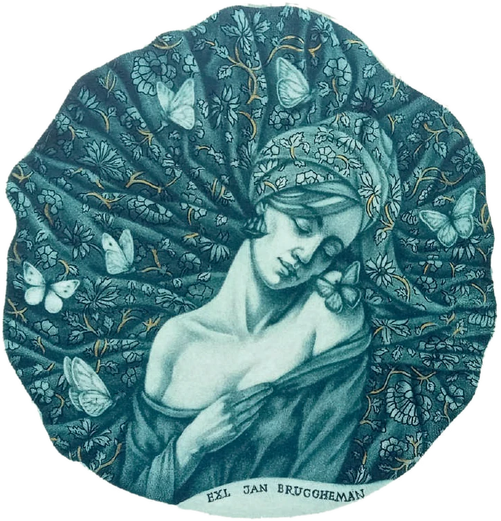{group="exlibris" fig-alt="In dreams, 2021" description="<em>In dreams</em>, 2021. Mezzotint on paper, ⌀ 14 cm"}

[*In dreams*, 2021]{.t} [Mezzotint on paper, ⌀ 14 cm]{.m}
:::::

::::: {.work}
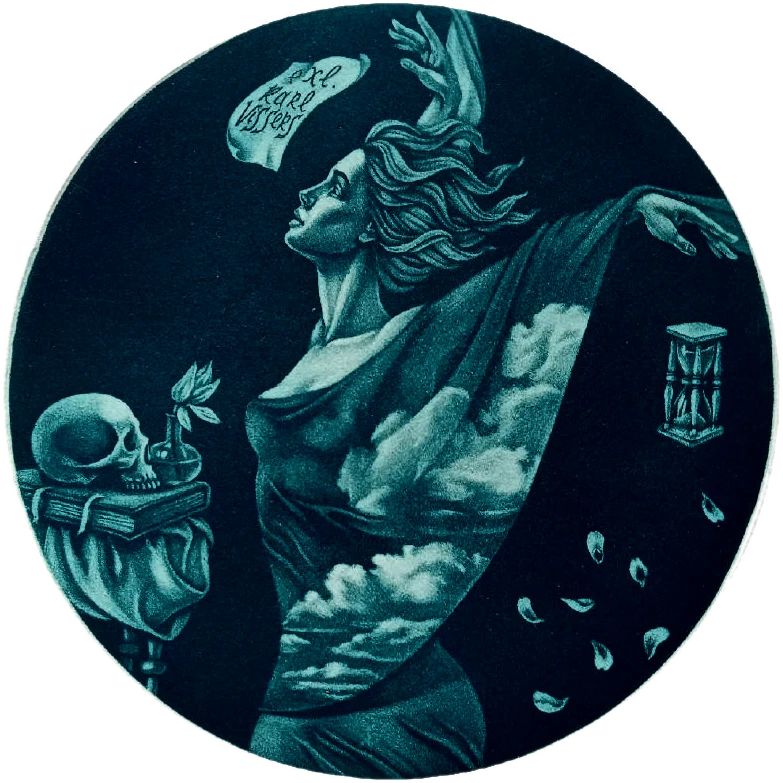{group="exlibris" fig-alt="Vanity, 2021" description="<em>Vanity</em>, 2021. Mezzotint on paper, ⌀ 14 cm"}

[*Vanity*, 2021]{.t} [Mezzotint on paper, ⌀ 14 cm]{.m}
:::::

::::: {.work}
{group="exlibris" fig-alt="Books catcher, 2023" description="<em>Books catcher</em>, 2023. Mezzotint on paper, ⌀ 14 cm"}

[*Books catcher*, 2023]{.t} [Mezzotint on paper, ⌀ 14 cm]{.m}
:::::

::::: {.work}
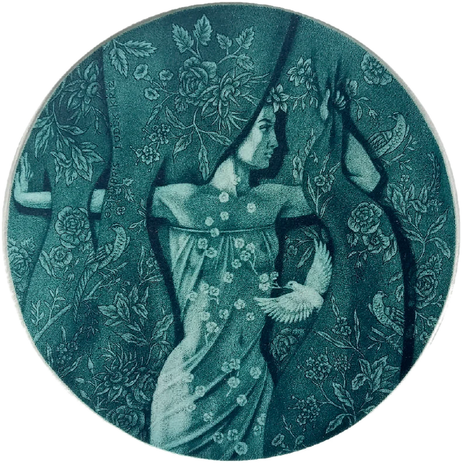{group="exlibris" fig-alt="In the secret garden, 2025" description="<em>In the secret garden</em>, 2025. Mezzotint on paper, ⌀ 14 cm"}

[*In the secret garden*, 2025]{.t} [Mezzotint on paper, ⌀ 14 cm]{.m}
:::::

::::

:::
