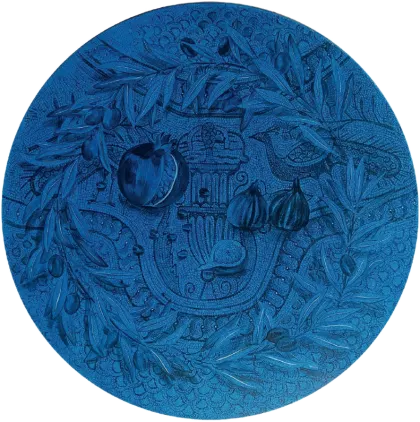
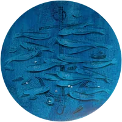
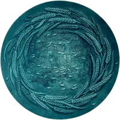
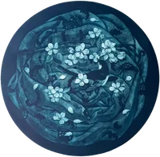
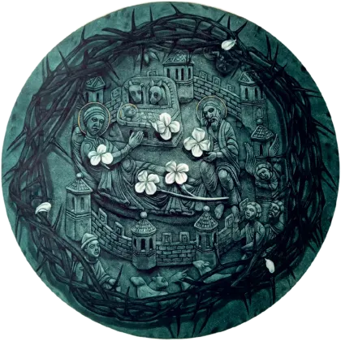
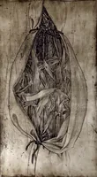
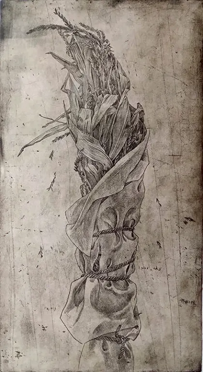
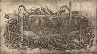
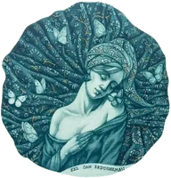
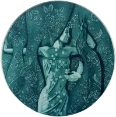

```{=html}
<section class="cat-head">
  <div class="cat-label mono">Catalogue of works</div>
  <h1 class="cat-title">Works <span class="cat-yrs">2020—2025</span></h1>
  <p class="cat-intro">24 works in three series, numbered as a catalogue. Select any title to view the plate large;
  switch to <em>To scale</em> to see every print at its true size relative to the others.</p>
</section>

<div class="cat-bar mono">
  <div class="cat-filters" role="group" aria-label="Series"><button class="on" data-f="all">All <sup>24</sup></button><button data-f="evidences">Evidences <sup>06</sup></button><button data-f="harvest">Harvest <sup>06</sup></button><button data-f="exlibris">Ex libris <sup>12</sup></button></div>
  <div class="cat-views" role="group" aria-label="View">
    <button class="on" data-v="index">Index</button><button data-v="scale">To scale</button>
  </div>
</div>

<section class="view-index">
  <div class="ix-head mono" role="presentation">
    <button data-sort="no" class="on">No.</button><span class="c-th"></span><button data-sort="title">Title</button>
    <span class="c-series">Series</span><button data-sort="year" class="c-year">Year</button>
    <span class="c-medium">Medium</span><span class="c-size">Size</span>
  </div>
  <ol class="ix" id="ix">
    <li class="grp" data-series="evidences"><span class="grp-no">I</span><span class="grp-name">Evidences</span><span class="grp-yrs">2021–2025</span><span class="grp-n">06 works</span><p class="grp-text">Round compositions in mezzotint and acrylic: symbolic still lifes on faith and sacrifice, shown in the solo exhibition <em>Evidences</em> at Terra Graphica Sacrum, Palace of Art, Minsk (2024).</p></li>
    <li class="row" data-i="0" data-series="evidences" data-year="2025" data-title="Reconciliation circle"><a href="images/works/reconciliation-circle.jpg" class="row-a"><span class="c-no">01</span><span class="c-th"></span><span class="c-title">Reconciliation circle</span><span class="c-series">Evidences</span><span class="c-year">2025</span><span class="c-medium">Acrylic on hardboard</span><span class="c-size">⌀ 50 cm</span></a></li>
    <li class="row" data-i="1" data-series="evidences" data-year="2025" data-title="Salvific meal"><a href="images/works/salvific-meal.jpg" class="row-a"><span class="c-no">02</span><span class="c-th"></span><span class="c-title">Salvific meal</span><span class="c-series">Evidences</span><span class="c-year">2025</span><span class="c-medium">Acrylic on hardboard</span><span class="c-size">⌀ 50 cm</span></a></li>
    <li class="row" data-i="2" data-series="evidences" data-year="2025" data-title="Quiet refuge"><a href="images/works/quiet-refuge.jpg" class="row-a"><span class="c-no">03</span><span class="c-th"></span><span class="c-title">Quiet refuge</span><span class="c-series">Evidences</span><span class="c-year">2025</span><span class="c-medium">Acrylic on hardboard</span><span class="c-size">⌀ 50 cm</span></a></li>
    <li class="row" data-i="3" data-series="evidences" data-year="2025" data-title="Harvest time"><a href="images/works/harvest-time.jpg" class="row-a"><span class="c-no">04</span><span class="c-th"></span><span class="c-title">Harvest time</span><span class="c-series">Evidences</span><span class="c-year">2025</span><span class="c-medium">Mezzotint on paper</span><span class="c-size">⌀ 50 cm</span></a></li>
    <li class="row" data-i="4" data-series="evidences" data-year="2022" data-title="Great expectations"><a href="images/works/great-expectations.jpg" class="row-a"><span class="c-no">05</span><span class="c-th"></span><span class="c-title">Great expectations</span><span class="c-series">Evidences</span><span class="c-year">2022</span><span class="c-medium">Mezzotint on paper</span><span class="c-size">⌀ 40 cm</span></a></li>
    <li class="row" data-i="5" data-series="evidences" data-year="2021" data-title="Predestination"><a href="images/works/predestination.jpg" class="row-a"><span class="c-no">06</span><span class="c-th"></span><span class="c-title">Predestination</span><span class="c-series">Evidences</span><span class="c-year">2021</span><span class="c-medium">Mezzotint on paper</span><span class="c-size">⌀ 40 cm</span></a></li>
    <li class="grp" data-series="harvest"><span class="grp-no">II</span><span class="grp-name">Harvest</span><span class="grp-yrs">2020–2025</span><span class="grp-n">06 works</span><p class="grp-text">Soft ground etchings of gathered, bound and abandoned things: stones, husks, leaves, a paper crane.</p></li>
    <li class="row" data-i="6" data-series="harvest" data-year="2023" data-title="Found"><a href="images/works/found.jpg" class="row-a"><span class="c-no">07</span><span class="c-th"></span><span class="c-title">Found</span><span class="c-series">Harvest</span><span class="c-year">2023</span><span class="c-medium">Soft ground etching on paper</span><span class="c-size">35 × 35 cm</span></a></li>
    <li class="row" data-i="7" data-series="harvest" data-year="2024" data-title="Good news"><a href="images/works/good-news.jpg" class="row-a"><span class="c-no">08</span><span class="c-th"></span><span class="c-title">Good news</span><span class="c-series">Harvest</span><span class="c-year">2024</span><span class="c-medium">Soft ground etching on paper</span><span class="c-size">35 × 35 cm</span></a></li>
    <li class="row" data-i="8" data-series="harvest" data-year="2025" data-title="New pearls"><a href="images/works/new-pearls.jpg" class="row-a"><span class="c-no">09</span><span class="c-th"></span><span class="c-title">New pearls</span><span class="c-series">Harvest</span><span class="c-year">2025</span><span class="c-medium">Soft ground etching on paper</span><span class="c-size">35 × 35 cm</span></a></li>
    <li class="row" data-i="9" data-series="harvest" data-year="2021" data-title="Binded"><a href="images/works/binded.jpg" class="row-a"><span class="c-no">10</span><span class="c-th"></span><span class="c-title">Binded</span><span class="c-series">Harvest</span><span class="c-year">2021</span><span class="c-medium">Soft ground etching on paper</span><span class="c-size">64 × 34 cm</span></a></li>
    <li class="row" data-i="10" data-series="harvest" data-year="2021" data-title="Wide open"><a href="images/works/wide-open.jpg" class="row-a"><span class="c-no">11</span><span class="c-th"></span><span class="c-title">Wide open</span><span class="c-series">Harvest</span><span class="c-year">2021</span><span class="c-medium">Soft ground etching on paper</span><span class="c-size">64 × 34 cm</span></a></li>
    <li class="row" data-i="11" data-series="harvest" data-year="2020" data-title="Abandoned"><a href="images/works/abandoned.jpg" class="row-a"><span class="c-no">12</span><span class="c-th"></span><span class="c-title">Abandoned</span><span class="c-series">Harvest</span><span class="c-year">2020</span><span class="c-medium">Soft ground etching on paper</span><span class="c-size">40 × 70 cm</span></a></li>
    <li class="grp" data-series="exlibris"><span class="grp-no">III</span><span class="grp-name">Ex libris</span><span class="grp-yrs">2021–2025</span><span class="grp-n">12 works</span><p class="grp-text">Bookplates in mezzotint, ⌀ 14 cm: small allegories of reading, memory and dreaming.</p></li>
    <li class="row" data-i="12" data-series="exlibris" data-year="2023" data-title="Bittersweet memories"><a href="images/works/bittersweet-memories.jpg" class="row-a"><span class="c-no">13</span><span class="c-th"></span><span class="c-title">Bittersweet memories</span><span class="c-series">Ex libris</span><span class="c-year">2023</span><span class="c-medium">Mezzotint on paper</span><span class="c-size">⌀ 14 cm</span></a></li>
    <li class="row" data-i="13" data-series="exlibris" data-year="2021" data-title="Treasure"><a href="images/works/treasure.jpg" class="row-a"><span class="c-no">14</span><span class="c-th"></span><span class="c-title">Treasure</span><span class="c-series">Ex libris</span><span class="c-year">2021</span><span class="c-medium">Mezzotint on paper</span><span class="c-size">⌀ 14 cm</span></a></li>
    <li class="row" data-i="14" data-series="exlibris" data-year="2023" data-title="Hommage Giorgio de Chirico"><a href="images/works/hommage-de-chirico.jpg" class="row-a"><span class="c-no">15</span><span class="c-th"></span><span class="c-title">Hommage Giorgio de Chirico</span><span class="c-series">Ex libris</span><span class="c-year">2023</span><span class="c-medium">Mezzotint on paper</span><span class="c-size">⌀ 14 cm</span></a></li>
    <li class="row" data-i="15" data-series="exlibris" data-year="2022" data-title="In flight"><a href="images/works/in-flight.jpg" class="row-a"><span class="c-no">16</span><span class="c-th"></span><span class="c-title">In flight</span><span class="c-series">Ex libris</span><span class="c-year">2022</span><span class="c-medium">Mezzotint on paper</span><span class="c-size">⌀ 14 cm</span></a></li>
    <li class="row" data-i="16" data-series="exlibris" data-year="2023" data-title="Cognition"><a href="images/works/cognition.jpg" class="row-a"><span class="c-no">17</span><span class="c-th"></span><span class="c-title">Cognition</span><span class="c-series">Ex libris</span><span class="c-year">2023</span><span class="c-medium">Mezzotint on paper</span><span class="c-size">⌀ 14 cm</span></a></li>
    <li class="row" data-i="17" data-series="exlibris" data-year="2023" data-title="West Side Story"><a href="images/works/west-side-story.jpg" class="row-a"><span class="c-no">18</span><span class="c-th"></span><span class="c-title">West Side Story</span><span class="c-series">Ex libris</span><span class="c-year">2023</span><span class="c-medium">Mezzotint on paper</span><span class="c-size">⌀ 14 cm</span></a></li>
    <li class="row" data-i="18" data-series="exlibris" data-year="2022" data-title="At rest"><a href="images/works/at-rest.jpg" class="row-a"><span class="c-no">19</span><span class="c-th"></span><span class="c-title">At rest</span><span class="c-series">Ex libris</span><span class="c-year">2022</span><span class="c-medium">Mezzotint on paper</span><span class="c-size">⌀ 14 cm</span></a></li>
    <li class="row" data-i="19" data-series="exlibris" data-year="2022" data-title="Hommage René Magritte"><a href="images/works/hommage-magritte.jpg" class="row-a"><span class="c-no">20</span><span class="c-th"></span><span class="c-title">Hommage René Magritte</span><span class="c-series">Ex libris</span><span class="c-year">2022</span><span class="c-medium">Mezzotint on paper</span><span class="c-size">⌀ 14 cm</span></a></li>
    <li class="row" data-i="20" data-series="exlibris" data-year="2021" data-title="In dreams"><a href="images/works/in-dreams.jpg" class="row-a"><span class="c-no">21</span><span class="c-th"></span><span class="c-title">In dreams</span><span class="c-series">Ex libris</span><span class="c-year">2021</span><span class="c-medium">Mezzotint on paper</span><span class="c-size">⌀ 14 cm</span></a></li>
    <li class="row" data-i="21" data-series="exlibris" data-year="2021" data-title="Vanity"><a href="images/works/vanity.jpg" class="row-a"><span class="c-no">22</span><span class="c-th"></span><span class="c-title">Vanity</span><span class="c-series">Ex libris</span><span class="c-year">2021</span><span class="c-medium">Mezzotint on paper</span><span class="c-size">⌀ 14 cm</span></a></li>
    <li class="row" data-i="22" data-series="exlibris" data-year="2023" data-title="Books catcher"><a href="images/works/books-catcher.jpg" class="row-a"><span class="c-no">23</span><span class="c-th"></span><span class="c-title">Books catcher</span><span class="c-series">Ex libris</span><span class="c-year">2023</span><span class="c-medium">Mezzotint on paper</span><span class="c-size">⌀ 14 cm</span></a></li>
    <li class="row" data-i="23" data-series="exlibris" data-year="2025" data-title="In the secret garden"><a href="images/works/in-the-secret-garden.jpg" class="row-a"><span class="c-no">24</span><span class="c-th"></span><span class="c-title">In the secret garden</span><span class="c-series">Ex libris</span><span class="c-year">2025</span><span class="c-medium">Mezzotint on paper</span><span class="c-size">⌀ 14 cm</span></a></li>
  </ol>
</section>

<section class="view-scale" hidden>
  <div class="scale-bar mono"><span class="scale-rule"></span>10 cm</div>
  <div class="plates">
    <button class="plate" data-i="0" data-series="evidences" style="--w:50;--h:50" aria-label="Reconciliation circle, 2025"><span class="plate-cap"><b>01</b> Reconciliation circle</span></button>
    <button class="plate" data-i="1" data-series="evidences" style="--w:50;--h:50" aria-label="Salvific meal, 2025"><span class="plate-cap"><b>02</b> Salvific meal</span></button>
    <button class="plate" data-i="2" data-series="evidences" style="--w:50;--h:50" aria-label="Quiet refuge, 2025"><span class="plate-cap"><b>03</b> Quiet refuge</span></button>
    <button class="plate" data-i="3" data-series="evidences" style="--w:50;--h:50" aria-label="Harvest time, 2025"><span class="plate-cap"><b>04</b> Harvest time</span></button>
    <button class="plate" data-i="4" data-series="evidences" style="--w:40;--h:40" aria-label="Great expectations, 2022"><span class="plate-cap"><b>05</b> Great expectations</span></button>
    <button class="plate" data-i="5" data-series="evidences" style="--w:40;--h:40" aria-label="Predestination, 2021"><span class="plate-cap"><b>06</b> Predestination</span></button>
    <button class="plate" data-i="6" data-series="harvest" style="--w:35;--h:35" aria-label="Found, 2023"><span class="plate-cap"><b>07</b> Found</span></button>
    <button class="plate" data-i="7" data-series="harvest" style="--w:35;--h:35" aria-label="Good news, 2024"><span class="plate-cap"><b>08</b> Good news</span></button>
    <button class="plate" data-i="8" data-series="harvest" style="--w:35;--h:35" aria-label="New pearls, 2025"><span class="plate-cap"><b>09</b> New pearls</span></button>
    <button class="plate" data-i="9" data-series="harvest" style="--w:34;--h:64" aria-label="Binded, 2021"><span class="plate-cap"><b>10</b> Binded</span></button>
    <button class="plate" data-i="10" data-series="harvest" style="--w:34;--h:64" aria-label="Wide open, 2021"><span class="plate-cap"><b>11</b> Wide open</span></button>
    <button class="plate" data-i="11" data-series="harvest" style="--w:70;--h:40" aria-label="Abandoned, 2020"><span class="plate-cap"><b>12</b> Abandoned</span></button>
    <button class="plate" data-i="12" data-series="exlibris" style="--w:14;--h:14" aria-label="Bittersweet memories, 2023"><span class="plate-cap"><b>13</b> Bittersweet memories</span></button>
    <button class="plate" data-i="13" data-series="exlibris" style="--w:14;--h:14" aria-label="Treasure, 2021"><span class="plate-cap"><b>14</b> Treasure</span></button>
    <button class="plate" data-i="14" data-series="exlibris" style="--w:14;--h:14" aria-label="Hommage Giorgio de Chirico, 2023"><span class="plate-cap"><b>15</b> Hommage Giorgio de Chirico</span></button>
    <button class="plate" data-i="15" data-series="exlibris" style="--w:14;--h:14" aria-label="In flight, 2022"><span class="plate-cap"><b>16</b> In flight</span></button>
    <button class="plate" data-i="16" data-series="exlibris" style="--w:14;--h:14" aria-label="Cognition, 2023"><span class="plate-cap"><b>17</b> Cognition</span></button>
    <button class="plate" data-i="17" data-series="exlibris" style="--w:14;--h:14" aria-label="West Side Story, 2023"><span class="plate-cap"><b>18</b> West Side Story</span></button>
    <button class="plate" data-i="18" data-series="exlibris" style="--w:14;--h:14" aria-label="At rest, 2022"><span class="plate-cap"><b>19</b> At rest</span></button>
    <button class="plate" data-i="19" data-series="exlibris" style="--w:14;--h:14" aria-label="Hommage René Magritte, 2022"><span class="plate-cap"><b>20</b> Hommage René Magritte</span></button>
    <button class="plate" data-i="20" data-series="exlibris" style="--w:14;--h:14" aria-label="In dreams, 2021"><span class="plate-cap"><b>21</b> In dreams</span></button>
    <button class="plate" data-i="21" data-series="exlibris" style="--w:14;--h:14" aria-label="Vanity, 2021"><span class="plate-cap"><b>22</b> Vanity</span></button>
    <button class="plate" data-i="22" data-series="exlibris" style="--w:14;--h:14" aria-label="Books catcher, 2023"><span class="plate-cap"><b>23</b> Books catcher</span></button>
    <button class="plate" data-i="23" data-series="exlibris" style="--w:14;--h:14" aria-label="In the secret garden, 2025"><span class="plate-cap"><b>24</b> In the secret garden</span></button>
  </div>
</section>

<div class="follower" aria-hidden="true"><span class="follower-no mono"></span></div>

<div class="viewer" hidden tabindex="-1" role="dialog" aria-modal="true" aria-label="Work viewer">
  <div class="v-stage"></div>
  <aside class="v-meta">
    <div class="v-count mono"><span class="v-no"></span> / 24</div>
    <h2 class="v-title"></h2>
    <dl class="v-dl mono">
      <dt>Year</dt><dd class="v-year"></dd>
      <dt>Medium</dt><dd class="v-medium"></dd>
      <dt>Size</dt><dd class="v-size"></dd>
      <dt>Series</dt><dd class="v-series"></dd>
    </dl>
    <button class="v-detail mono" hidden>View detail</button>
  </aside>
  <div class="v-nav mono">
    <button class="v-prev" aria-label="Previous work">← Prev</button>
    <button class="v-next" aria-label="Next work">Next →</button>
    <button class="v-close" aria-label="Close">Close ✕</button>
  </div>
</div>

<script type="application/json" id="works-data">[{"no": "01", "slug": "reconciliation-circle", "title": "Reconciliation circle", "year": 2025, "medium": "Acrylic on hardboard", "size": "⌀ 50 cm", "series": "Evidences", "seriesKey": "evidences", "detail": false, "w": 50.0, "h": 50.0}, {"no": "02", "slug": "salvific-meal", "title": "Salvific meal", "year": 2025, "medium": "Acrylic on hardboard", "size": "⌀ 50 cm", "series": "Evidences", "seriesKey": "evidences", "detail": false, "w": 50.0, "h": 50.0}, {"no": "03", "slug": "quiet-refuge", "title": "Quiet refuge", "year": 2025, "medium": "Acrylic on hardboard", "size": "⌀ 50 cm", "series": "Evidences", "seriesKey": "evidences", "detail": false, "w": 50.0, "h": 50.0}, {"no": "04", "slug": "harvest-time", "title": "Harvest time", "year": 2025, "medium": "Mezzotint on paper", "size": "⌀ 50 cm", "series": "Evidences", "seriesKey": "evidences", "detail": false, "w": 50.0, "h": 50.0}, {"no": "05", "slug": "great-expectations", "title": "Great expectations", "year": 2022, "medium": "Mezzotint on paper", "size": "⌀ 40 cm", "series": "Evidences", "seriesKey": "evidences", "detail": false, "w": 40.0, "h": 40.0}, {"no": "06", "slug": "predestination", "title": "Predestination", "year": 2021, "medium": "Mezzotint on paper", "size": "⌀ 40 cm", "series": "Evidences", "seriesKey": "evidences", "detail": false, "w": 40.0, "h": 40.0}, {"no": "07", "slug": "found", "title": "Found", "year": 2023, "medium": "Soft ground etching on paper", "size": "35 × 35 cm", "series": "Harvest", "seriesKey": "harvest", "detail": true, "w": 35.0, "h": 35.0}, {"no": "08", "slug": "good-news", "title": "Good news", "year": 2024, "medium": "Soft ground etching on paper", "size": "35 × 35 cm", "series": "Harvest", "seriesKey": "harvest", "detail": true, "w": 35.0, "h": 35.0}, {"no": "09", "slug": "new-pearls", "title": "New pearls", "year": 2025, "medium": "Soft ground etching on paper", "size": "35 × 35 cm", "series": "Harvest", "seriesKey": "harvest", "detail": false, "w": 35.0, "h": 35.0}, {"no": "10", "slug": "binded", "title": "Binded", "year": 2021, "medium": "Soft ground etching on paper", "size": "64 × 34 cm", "series": "Harvest", "seriesKey": "harvest", "detail": false, "w": 34.0, "h": 64.0}, {"no": "11", "slug": "wide-open", "title": "Wide open", "year": 2021, "medium": "Soft ground etching on paper", "size": "64 × 34 cm", "series": "Harvest", "seriesKey": "harvest", "detail": true, "w": 34.0, "h": 64.0}, {"no": "12", "slug": "abandoned", "title": "Abandoned", "year": 2020, "medium": "Soft ground etching on paper", "size": "40 × 70 cm", "series": "Harvest", "seriesKey": "harvest", "detail": true, "w": 70.0, "h": 40.0}, {"no": "13", "slug": "bittersweet-memories", "title": "Bittersweet memories", "year": 2023, "medium": "Mezzotint on paper", "size": "⌀ 14 cm", "series": "Ex libris", "seriesKey": "exlibris", "detail": false, "w": 14.0, "h": 14.0}, {"no": "14", "slug": "treasure", "title": "Treasure", "year": 2021, "medium": "Mezzotint on paper", "size": "⌀ 14 cm", "series": "Ex libris", "seriesKey": "exlibris", "detail": false, "w": 14.0, "h": 14.0}, {"no": "15", "slug": "hommage-de-chirico", "title": "Hommage Giorgio de Chirico", "year": 2023, "medium": "Mezzotint on paper", "size": "⌀ 14 cm", "series": "Ex libris", "seriesKey": "exlibris", "detail": false, "w": 14.0, "h": 14.0}, {"no": "16", "slug": "in-flight", "title": "In flight", "year": 2022, "medium": "Mezzotint on paper", "size": "⌀ 14 cm", "series": "Ex libris", "seriesKey": "exlibris", "detail": false, "w": 14.0, "h": 14.0}, {"no": "17", "slug": "cognition", "title": "Cognition", "year": 2023, "medium": "Mezzotint on paper", "size": "⌀ 14 cm", "series": "Ex libris", "seriesKey": "exlibris", "detail": false, "w": 14.0, "h": 14.0}, {"no": "18", "slug": "west-side-story", "title": "West Side Story", "year": 2023, "medium": "Mezzotint on paper", "size": "⌀ 14 cm", "series": "Ex libris", "seriesKey": "exlibris", "detail": false, "w": 14.0, "h": 14.0}, {"no": "19", "slug": "at-rest", "title": "At rest", "year": 2022, "medium": "Mezzotint on paper", "size": "⌀ 14 cm", "series": "Ex libris", "seriesKey": "exlibris", "detail": false, "w": 14.0, "h": 14.0}, {"no": "20", "slug": "hommage-magritte", "title": "Hommage René Magritte", "year": 2022, "medium": "Mezzotint on paper", "size": "⌀ 14 cm", "series": "Ex libris", "seriesKey": "exlibris", "detail": false, "w": 14.0, "h": 14.0}, {"no": "21", "slug": "in-dreams", "title": "In dreams", "year": 2021, "medium": "Mezzotint on paper", "size": "⌀ 14 cm", "series": "Ex libris", "seriesKey": "exlibris", "detail": false, "w": 14.0, "h": 14.0}, {"no": "22", "slug": "vanity", "title": "Vanity", "year": 2021, "medium": "Mezzotint on paper", "size": "⌀ 14 cm", "series": "Ex libris", "seriesKey": "exlibris", "detail": false, "w": 14.0, "h": 14.0}, {"no": "23", "slug": "books-catcher", "title": "Books catcher", "year": 2023, "medium": "Mezzotint on paper", "size": "⌀ 14 cm", "series": "Ex libris", "seriesKey": "exlibris", "detail": false, "w": 14.0, "h": 14.0}, {"no": "24", "slug": "in-the-secret-garden", "title": "In the secret garden", "year": 2025, "medium": "Mezzotint on paper", "size": "⌀ 14 cm", "series": "Ex libris", "seriesKey": "exlibris", "detail": false, "w": 14.0, "h": 14.0}]</script>
```
